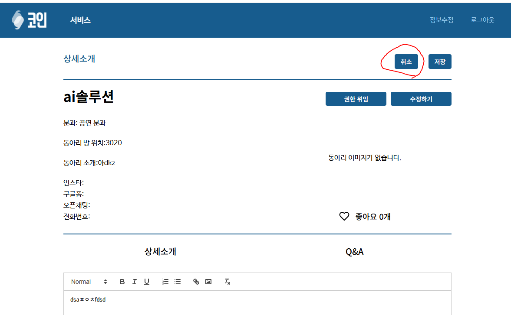
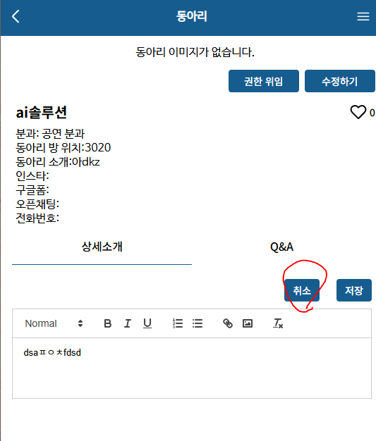

# [레거시] 5-9.동아리_상세소개 수정하기_취소 클릭

원문 페이지 ID: 6850221954bc82e794da0197a665ca21

> 원문 스냅샷. 명세 확정·앱 배포·수집 완료를 뜻하지 않습니다.

## 원문 속성

```json
{
  "platform": [
    "WEB"
  ],
  "url": "source-page-id:6850221954bc82e794da0197a665ca21",
  "상태": "레거시",
  "이름": "\\[레거시\\] 5-9.동아리\\_상세소개 수정하기\\_취소 클릭",
  "태그": [
    "5.동아리_소개화면"
  ]
}
```

<callout icon="🗃️" color="gray_bg">
<b>레거시 — 동아리 로깅 전체 현행 적용 제외</b>

- 2026-11-04 사용자 지시로 동아리 로깅 전체를 레거시로 보존한다. 이 페이지는 신규 구현·추가 전송·새 네이밍 적용의 기준이 아니다.
- 기존 event\_name·event\_label·value·category·사진·플랫폼과 원문을 그대로 보존한다. 새 라벨을 만들거나 DA1/DA2로 재배정하지 않는다.
- 서비스 전체 기준: [동아리 - 레거시](1880221954bc82f98785817f02a64b99.md). 실제 SDK 수집 종료 여부는 별도 확인 대상이다.
</callout>

<ul>
<li>
설명: 동아리 소개 화면 → 상세소개 수정하기를 누른후 → 취소 버튼 클릭
</li>
<li>
event\_name : “CAMPUS”
</li>
<li>
event\_label : “club\_introduction\_correction\_cancel”
</li>
<li>
value : “취소”
</li>
<li>
event\_category : “click” 
</li>
</ul>


- 웹 참고사진




- 모바일 웹 뷰




