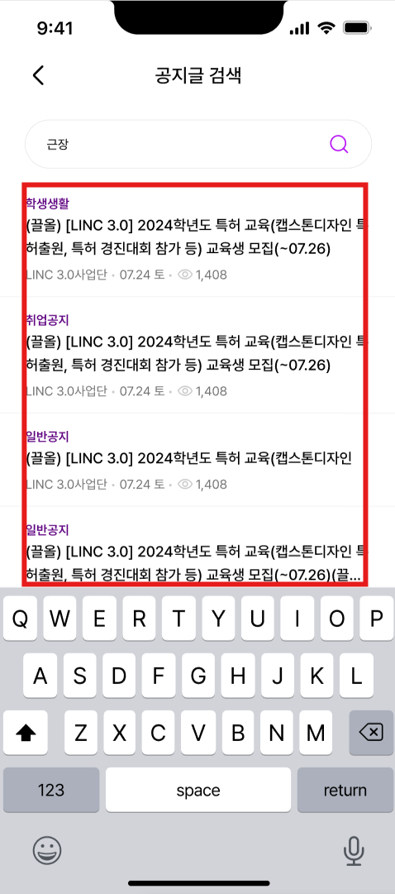

# 6-4. 공지글 검색_공지상세_클릭 

원문 페이지 ID: 6900221954bc83c19cd4816a488a3488

> 원문 스냅샷. 명세 확정·앱 배포·수집 완료를 뜻하지 않습니다.

## 원문 속성

```json
{
  "platform": [
    "ANDROID",
    "IOS"
  ],
  "url": "source-page-id:6900221954bc83c19cd4816a488a3488",
  "상태": "로깅 필요",
  "이름": "<p>\n6-4. 공지글 검색\\_공지상세\\_클릭 \n</p>",
  "태그": [
    "6. 공지글 검색(APP)"
  ]
}
```

이전 로깅 없음

<details>
<summary>새 로깅 (26.10.05)</summary>

- 설명: 공지글 검색 화면에서 검색된 공지 클릭
- screen\_view: <code>notice_search</code>
- event\_name: <code>DA2</code>
- event\_label: <code>board__notice_search__notice_detail__entry__click</code>
- value: \{공지 ID\}
  - 이것도 안되면 공지 제목으로 대체해주세요
- event\_category: <code>click</code>

<details>
<summary>검토사항</summary>

- label 통일 (2026-10-27): <code>board__notice_search__notice_detail__entry</code> → <code>board__notice_search__notice_detail__entry__click</code>
</details>

<details>
<summary>참고사진 · 모바일</summary>

<b>모바일</b>


</details>
</details>
