# 7-1. 프로필 내부

원문 페이지 ID: 6910221954bc834a9b9f014041ebd68b

> 원문 스냅샷. 명세 확정·앱 배포·수집 완료를 뜻하지 않습니다.

## 원문 속성

```json
{
  "platform": [
    "WEB",
    "ANDROID",
    "IOS"
  ],
  "url": "source-page-id:6910221954bc834a9b9f014041ebd68b",
  "구분": "프로필",
  "상태": "로깅 필요",
  "생성일": "2026-11-08T10:52:09.703Z",
  "이벤트 이름": "7-1. 프로필 내부"
}
```

<details>
<summary>이전 로깅</summary>

① 프로필 수정하기

- event\_label : team\_recruitment\_profile\_modify
- value : 프로필 수정하기
- event\_category : “click”


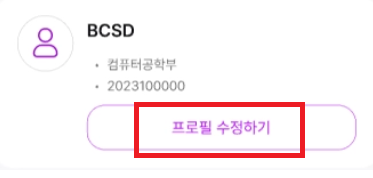

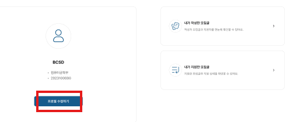

② 프로필 작성하기

- event\_label : team\_recruitment\_profile\_create
- value : 프로필 작성하기
- event\_category : “click”


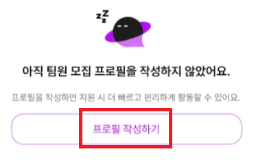

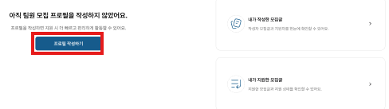

③ 내가 작성한 모집글

- event\_label : team\_recruitment\_profile\_created
- value : 내가 작성한 모집글
- event\_category : click

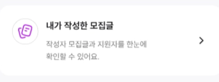

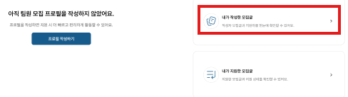

④ 내가 지원한 모집글

- event\_label : team\_recruitment\_profile\_applied
- value : 내가 지원한 모집글
- event\_category : click

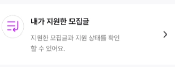

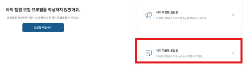
</details>

<details>
<summary>새 로깅 (26.10.17)</summary>

① 프로필 수정하기

- 설명: 팀원 모집 프로필 화면에서 프로필 수정하기 버튼을 클릭해 프로필 수정 화면으로 들어가는 경우 (프로필이 이미 있을 때)
- screen\_view: <code>team_profile</code>
- event\_name: <code>DA1</code>
- event\_label: <code>team_recruit__team_profile__profile_edit__entry__click</code>
- value: 프로필 수정하기
- event\_category: <code>click</code>

② 프로필 작성하기

- 설명: 팀원 모집 프로필 화면에서 프로필 작성하기 버튼을 클릭해 프로필 작성 화면으로 들어가는 경우 (프로필이 없을 때)
- screen\_view: <code>team_profile</code>
- event\_name: <code>DA1</code>
- event\_label: <code>team_recruit__team_profile__team_profile_write__entry__click</code>
- value: 프로필 작성하기
- event\_category: <code>click</code>

③ 내가 작성한 모집글

- 설명: 팀원 모집 프로필 화면에서 내가 작성한 모집글을 클릭해 내가 작성한 모집글 화면으로 들어가는 경우
- screen\_view: <code>team_profile</code>
- event\_name: <code>DA1</code>
- event\_label: <code>team_recruit__team_profile__team_created__entry__click</code>
- value: 내가 작성한 모집글
- event\_category: <code>click</code>

④ 내가 지원한 모집글

- 설명: 팀원 모집 프로필 화면에서 내가 지원한 모집글을 클릭해 내가 지원한 모집글 화면으로 들어가는 경우
- screen\_view: <code>team_profile</code>
- event\_name: <code>DA1</code>
- event\_label: <code>team_recruit__team_profile__team_applied__entry__click</code>
- value: 내가 지원한 모집글
- event\_category: <code>click</code>

<details>
<summary>검토사항</summary>

- 통합 가이드·후속: [로깅 통합 가이드](3c30221954bc8214b1c481c5bbb6fba5.md)
- ② 참고사진: 테스트 계정에 이미 프로필이 있어 프로필 작성하기 버튼이 보이지 않음(프로필 삭제 불가로 캡처 안 함). 작성 화면 자체는 7-1-2 참고
- label DA2 기준 정렬 (2026-10-27): <code>team_recruit__team_profile__write__click</code> → <code>team_recruit__team_profile__team_profile_write__entry__click</code>
- label DA2 기준 정렬 (2026-10-27): <code>team_recruit__team_profile__created__click</code> → <code>team_recruit__team_profile__team_created__entry__click</code>
- label DA2 기준 정렬 (2026-10-27): <code>team_recruit__team_profile__applied__click</code> → <code>team_recruit__team_profile__team_applied__entry__click</code>
- label DA2 기준 정렬 (2026-10-27): <code>team_recruit__team_profile__edit__click</code> → <code>team_recruit__team_profile__profile_edit__entry__click</code>
- 사진은 stage 로그인 상태 캡처. 사진 플랫폼 확인 완료 (이미지 비율 기준: 모바일, 780x1688). 웹 사진 추가 필요
</details>

### 참고사진 (프로필 내부)

① 프로필 수정하기

<columns>
<column ratio="50">
<b>웹</b>

<details>
<summary>참고사진 · 웹</summary>

웹 — 사진 없음 (추가 필요)
</details>
</column>
<column ratio="50">
<b>모바일</b>

<details>
<summary>참고사진 · 모바일</summary>

모바일 — 프로필 수정하기 (출처: stage 실제 캡처, 빨간 네모 = 클릭 위치)

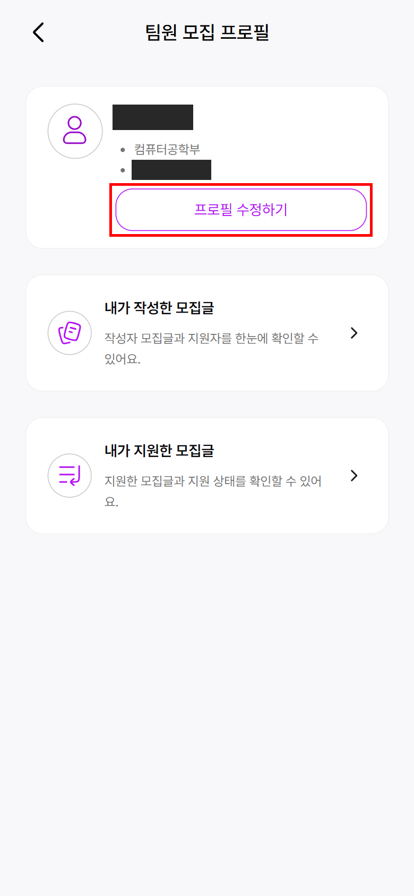
</details>
</column>
</columns>

② 프로필 작성하기

<columns>
<column ratio="50">
<b>웹</b>

<details>
<summary>참고사진 · 웹</summary>

웹 — 사진 없음 (추가 필요)
</details>
</column>
<column ratio="50">
<b>모바일</b>

<details>
<summary>참고사진 · 모바일</summary>

모바일 — 사진 없음 (추가 필요)
</details>
</column>
</columns>

③ 내가 작성한 모집글

<columns>
<column ratio="50">
<b>웹</b>

<details>
<summary>참고사진 · 웹</summary>

웹 — 사진 없음 (추가 필요)
</details>
</column>
<column ratio="50">
<b>모바일</b>

<details>
<summary>참고사진 · 모바일</summary>

모바일 — 내가 작성한 모집글 (출처: stage 실제 캡처, 빨간 네모 = 클릭 위치)

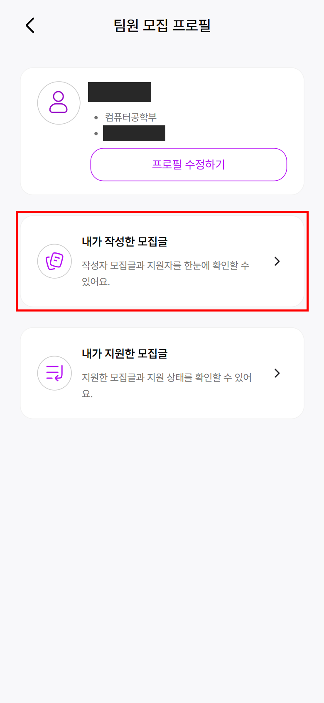
</details>
</column>
</columns>

④ 내가 지원한 모집글

<columns>
<column ratio="50">
<b>웹</b>

<details>
<summary>참고사진 · 웹</summary>

웹 — 사진 없음 (추가 필요)
</details>
</column>
<column ratio="50">
<b>모바일</b>

<details>
<summary>참고사진 · 모바일</summary>

모바일 — 내가 지원한 모집글 (출처: stage 실제 캡처, 빨간 네모 = 클릭 위치)

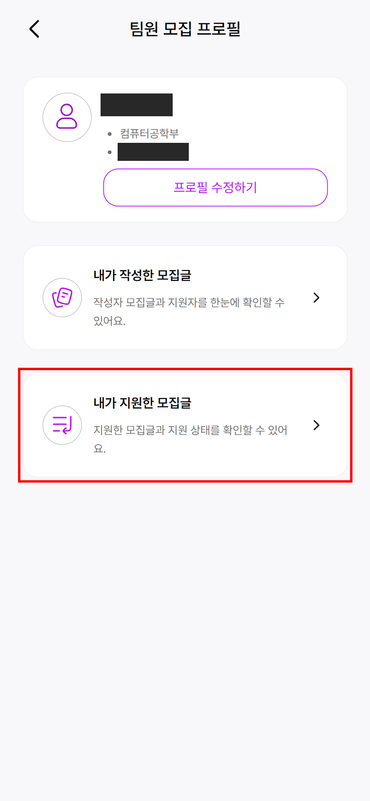
</details>
</column>
</columns>
</details>
