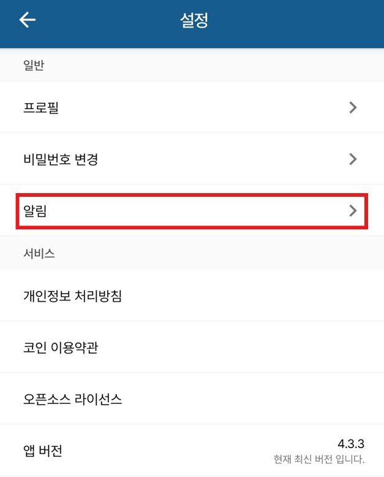

# 5-1. (Android / iOS) 알림설정_클릭

원문 페이지 ID: 6970221954bc82d29e6301ca89419c5c

> 누락 원본 복구 스냅샷. 원본의 과거값·검토 기록을 보존하며 생성 계약으로 자동 승인하지 않습니다.

대조 기록: [87개 원본 복구 및 8개 차이 정리](../recovery-review.md)

관련 기존 보관본: [5-1. (Android / iOS) 알림설정_클릭](1190221954bc83939928017b5b644090.md)

## 원문 속성

```json
{
  "platform": [
    "ANDROID",
    "IOS"
  ],
  "url": "source-page-id:6970221954bc82d29e6301ca89419c5c",
  "상태": "완료",
  "생성일": "2026-11-08T10:51:37.249Z",
  "이름": "5-1. (Android / iOS) 알림설정\\_클릭",
  "태그": [
    "5. 알림설정 페이지 (Android / iOS)"
  ]
}
```

<details>
<summary>이전 로깅</summary>


- 설명 : 설정에서 알림 클릭
- event\_label : “notification”
- value : “알림설정<b>”</b>
- event\_category : “click”
- 참고사진





</details>


<details>
<summary>새 로깅 (26.10.17)</summary>


- 설명: 프로필 → 설정 화면에서 알림을 클릭해 알림 설정 화면으로 들어가는 경우
- screen\_view: <code>account_config</code>
- event\_name: <code>DA1</code>
- event\_label: <code>cafeteria__account_config__notification_config__entry__click</code>
- value: 알림설정
- event\_category: <code>click</code>

<details>
<summary>검토사항</summary>


- 통합 가이드·후속: [로깅 통합 가이드](3c30221954bc8214b1c481c5bbb6fba5.md)
- 웹: 없음 (앱 전용)
- label DA2 기준 정렬 (2026-10-27): <code>cafeteria__account_config__notification__click</code> → <code>cafeteria__account_config__notification_config__entry__click</code>

</details>


### 참고사진 (알림설정 클릭)


<b>웹</b>

<details>
<summary>참고사진 · 웹</summary>


해당 없음 (앱 전용)

</details>


<b>모바일</b>

<details>
<summary>참고사진 · 모바일</summary>


출처: 이 페이지 이전 로깅의 기존 앱 참고사진 사본. 표시 대상은 현행 설명과 대조했으며, 현행 앱의 화면·구현은 미검증입니다. 빨간 네모는 동작 대상입니다.

파란색 구버전 모바일 사진 제거 (2026-10-30).

</details>


</details>
