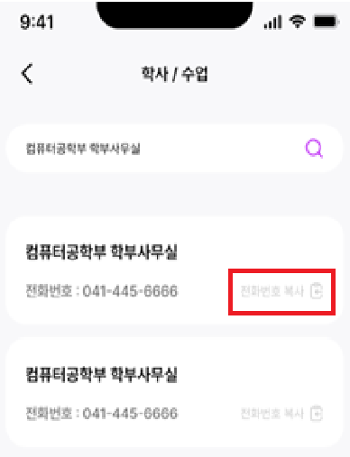
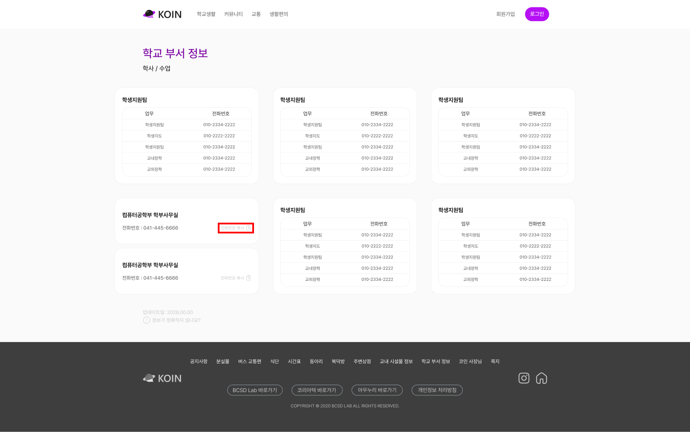
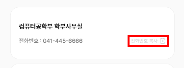
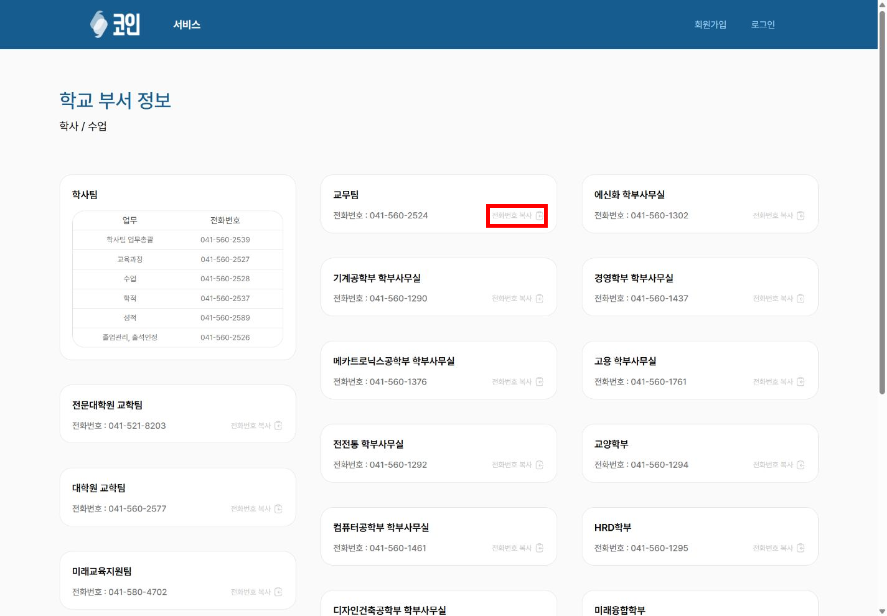
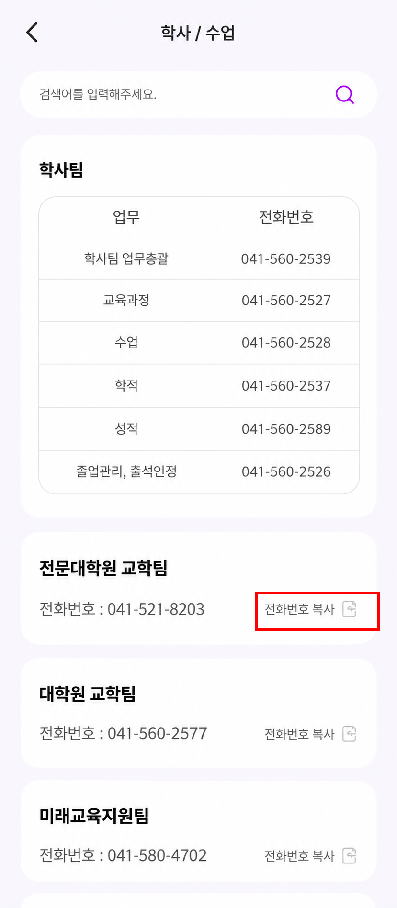

# 1-3 전화번호 복사

원문 페이지 ID: 69f0221954bc83e8a92501ec1f7f3f58

> 원문 스냅샷. 명세 확정·앱 배포·수집 완료를 뜻하지 않습니다.

## 원문 속성

```json
{
  "platform": [
    "ANDROID",
    "IOS",
    "WEB"
  ],
  "url": "source-page-id:69f0221954bc83e8a92501ec1f7f3f58",
  "구분": "학교 부서정보",
  "상태": "완료",
  "생성일": "2026-11-08T10:52:07.297Z",
  "이벤트 이름": "1-3 전화번호 복사"
}
```

<details>
<summary>이전 로깅</summary>

- event\_label : department\_contact\_copy
- value : 전화번호 복사
- event\_category : click



</details>

<details>
<summary>새 로깅 (2026-10-14) — 초안</summary>

<b>분류별 부서 목록</b>

- 설명: 부서 목록 카드에서 전화번호 복사 버튼을 클릭한다.
- screen\_view: <code>department_list</code>
- event\_label: <code>department__department_list__contact__phone_copy__click</code>

<b>WEB 검색 결과</b>

- 설명: 분류 화면의 페이지 내 검색 결과 카드에서 전화번호 복사를 클릭한다.
- screen\_view: <code>department_main</code>
- event\_label: <code>department__department_main__contact__phone_copy__click</code>
- event\_name: <code>DA2</code>
- value: 전화번호 복사
- event\_category: <code>click</code>

<details>
<summary>검토사항</summary>

- WEB 참고사진 반영 (2026-11-04 사용자 요청 정정): 아래 새 WEB 캡처와 빨간 네모·확대본을 기준으로 클릭 위치를 확인한다. 리디자인 전 WEB 사진은 이력으로 보존하며 모바일 사진·명세와 이전 로깅은 유지한다.
- WEB 리디자인 반영 (2026-11-04 사용자 승인): WEB: 분류별 상세 카드의 ‘전화번호 복사’ 텍스트·복사 아이콘은 department\_list, 분류 화면의 검색 결과 카드 내 복사는 department\_main의 기존 새 라벨을 적용한다. 번호 텍스트 클릭·전화 걸기·카드 노출을 복사로 간주하지 않는다. 검색 결과는 페이지 내 상태라는 기존 화면 계약을 유지하며 실제 라우팅은 미확인이다.
- WEB 설계 근거: [Figma 참고 / 실제 화면 미확인](https://www.figma.com/design/DPlcYuiFxhyT5ULbqec59i/KOIN-Web?node-id=17699-29849). 기존 사진은 교체하지 않았으며 리디자인 화면의 위치 근거로 사용하지 않는다. SDK 구현·배포 시점·실제 수집은 미확인이다. 이 WEB 규정은 해당 화면의 과거 WEB 설명보다 우선하며 모바일·이전 로깅·기존 필드 값·DB 플랫폼 속성은 보존한다.
- 통합 가이드·후속: [로깅 통합 가이드](3c30221954bc8214b1c481c5bbb6fba5.md)
- label 통일 (2026-10-27): <code>department__department_list__contact__phone_copy</code> → <code>department__department_list__contact__phone_copy__click</code>, <code>department__department_main__contact__phone_copy</code> → <code>department__department_main__contact__phone_copy__click</code>
- WEB 검색 결과는 /department?keyword=...의 페이지 내 상태이므로 department\_main을 유지한다. Android 검색 결과·전화번호 복사 실제 화면은 사용자 확인 완료(2026-10-16). 기존 고정 화면별 명세를 유지한다.
</details>

### 참고사진 (기능 표시)

<b>웹(데스크톱)</b>

<details>
<summary>참고사진 · 웹</summary>

WEB 리디자인 · [Figma 시안](https://www.figma.com/design/DPlcYuiFxhyT5ULbqec59i/KOIN-Web?node-id=17699-29849) · 2026-11-04. 빨간 네모는 이 명세의 클릭 위치다. 원본 캡처에 코드로 테두리만 표시했으며 실제 서비스 캡처·배포 완료를 의미하지 않는다. 분류별 상세 목록의 복사 버튼 예시다. 검색 결과의 리디자인 화면은 별도 미확인이다.

<b>전체 화면</b>



<b>클릭 위치 확대</b>



<details>
<summary>이전 WEB 참고사진 (리디자인 전)</summary>

화면 정의의 실제 데스크톱 웹 캡처(2026-10-13). 이번 작업은 기존 캡처를 사용.


</details>
</details>

<b>모바일 (ANDROID, IOS) / 캡처 출처는 아래 참조</b>

<details>
<summary>참고사진 · 모바일</summary>

화면 정의의 Android 실제 캡처(2026-10-13), 선명도 개선본. 이번 작업은 기존 캡처를 사용.


</details>
</details>
