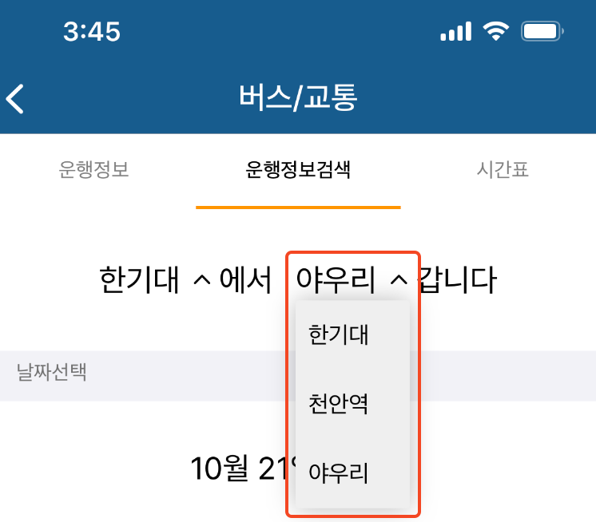

# 3-5. (Android / iOS) 버스_운행정보검색_목적지_클릭

원문 페이지 ID: 6a70221954bc8294bdf0816e2cf93a2c

> 원문 스냅샷. 명세 확정·앱 배포·수집 완료를 뜻하지 않습니다.

## 원문 속성

```json
{
  "platform": [
    "ANDROID",
    "IOS"
  ],
  "url": "source-page-id:6a70221954bc8294bdf0816e2cf93a2c",
  "구분": "운행정보검색 (Android / iOS)",
  "상태": "레거시",
  "생성일": "2026-11-12T05:07:51.997Z",
  "이벤트 이름": "3-5. <b>(Android / iOS) </b>버스\\_운행정보검색\\_목적지\\_클릭",
  "태그": [
    "3. 버스/교통 상세 페이지"
  ]
}
```

<details>
<summary>과거 로깅</summary>

- event\_label : “bus\_search\_arrival”
- value : “한기대 / 천안역 / 야우리<b>”</b>
- event\_category : “click”
- 참고사진


</details>

<details>
<summary>새 로깅</summary>

- 레거시: 지금 앱에 없는 화면(운행정보검색 탭)이라 새 로깅을 만들지 않는다.
- 대체 로깅: 5-4. 도착지\_확인\_클릭 (<code>bus__bus_search__search__arrival_confirm__select</code>)

### 참고사진 (기능 표시)

<columns>
<column ratio="50">
<b>웹</b>

<b>참고사진 · 웹</b>

웹 — 해당 없음 (레거시)
</column>
<column ratio="50">
<b>모바일</b>

<b>참고사진 · 모바일</b>

모바일 — 해당 없음 (레거시)
</column>
</columns>
</details>
