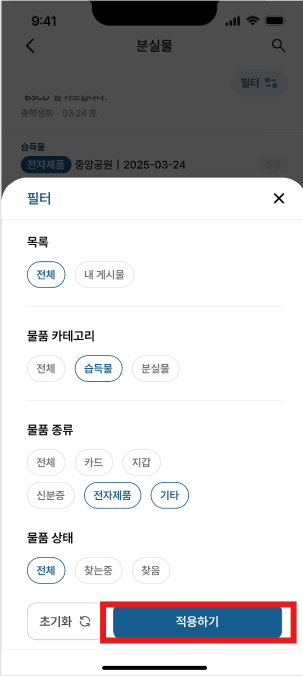
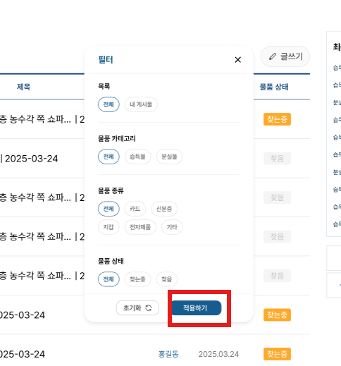
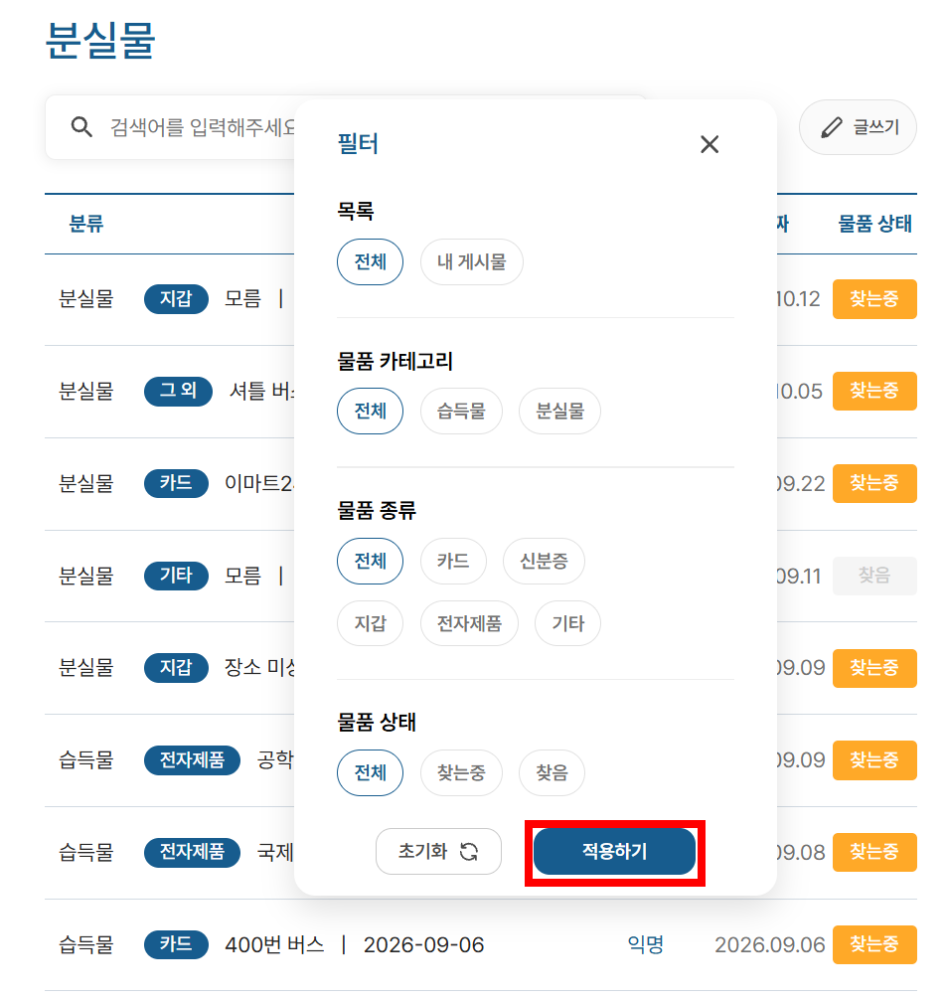
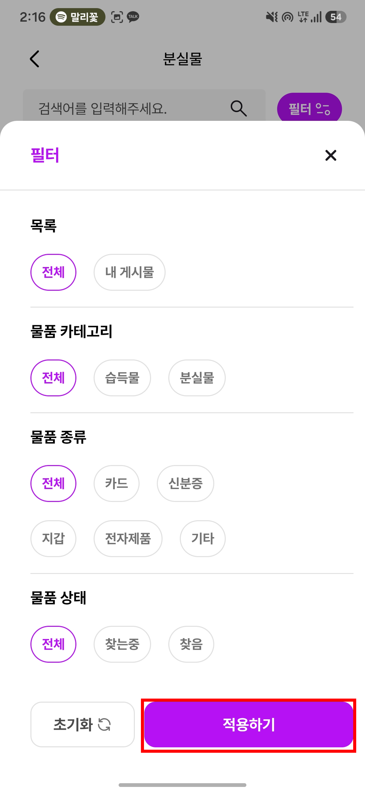

# 11-23. 분실물_필터_적용_클릭

원문 페이지 ID: 6ae0221954bc83f49fde814244d6dae4

> 원문 스냅샷. 명세 확정·앱 배포·수집 완료를 뜻하지 않습니다.

## 원문 속성

```json
{
  "platform": [
    "ANDROID",
    "IOS",
    "WEB"
  ],
  "url": "source-page-id:6ae0221954bc83f49fde814244d6dae4",
  "상태": "완료",
  "이름": "11-23. 분실물\\_필터\\_적용\\_클릭",
  "태그": [
    "11.분실물"
  ]
}
```

<details>
<summary>이전 로깅</summary>

- 설명: 필터 화면에서 적용하기 버튼 클릭
- event\_label : lost\_item\_filter\_apply
- value : 분실물
- event\_category : click
- 참고사진




</details>

<details>
<summary>새 로깅 (26.10.12) — 초안</summary>

- 설명: 필터 화면에서 적용하기 버튼 클릭
- screen\_view: <code>lost_item_list</code>
- event\_name: <code>DA2</code>
- event\_label: <code>board__lost_item_list__filter__apply__click</code>
- value: 분실물
- event\_category: <code>click</code>
- 전송 구조: 기존 value ‘분실물’은 공통 식별값으로 유지한다. 최종 필터 값은 아래 네 개의 별도 STRING 파라미터로 보낸다. 하나의 JSON·리스트 문자열로 합치지 않는다.

<table fit-page-width="true" header-row="true">
<tr>
<td>
파라미터
</td>
<td>
그룹
</td>
<td>
전송 값
</td>
</tr>
<tr>
<td>
<code>filter_scope</code>
</td>
<td>
목록
</td>
<td>
전체 / 내 게시물
</td>
</tr>
<tr>
<td>
<code>filter_post_type</code>
</td>
<td>
물품 카테고리
</td>
<td>
전체 / 습득물 / 분실물
</td>
</tr>
<tr>
<td>
<code>filter_item_type</code>
</td>
<td>
물품 종류
</td>
<td>
전체 / 카드 / 신분증 / 지갑 / 전자제품 / 기타. 복수 예: 카드\|지갑
</td>
</tr>
<tr>
<td>
<code>filter_status</code>
</td>
<td>
물품 상태
</td>
<td>
전체 / 찾는중 / 찾음
</td>
</tr>
</table>

- 공통 규칙: 매 적용 클릭마다 네 키를 모두 보낸다. 기본·전체 상태는 ‘전체’로 쓰고 키를 생략하지 않는다. 단일 선택은 해당 한국어 값 하나, UI가 허용하는 복수 선택은 중복 제거 후 정의된 UI 순서로 ‘\|’ 연결한다. 전체와 개별 값을 함께 넣지 않는다. 단일 선택 UI를 복수 선택으로 바꾸는 요구는 아니다.
- 예시: filter\_scope=‘전체’, filter\_post\_type=‘습득물’, filter\_item\_type=‘카드\|지갑’, filter\_status=‘찾는중’.
- 발생 범위: 필터 열기 11-22는 유지한다. 적용하지 않고 닫는 경우에는 이 적용 이벤트를 보내지 않는다. screen\_view는 lost\_item\_list이며, 모달 이름으로 바꾸지 않는다.

<details>
<summary>검토사항</summary>

- 통합 가이드·후속: [로깅 통합 가이드](3c30221954bc8214b1c481c5bbb6fba5.md)
- label 통일 (2026-10-27): <code>board__lost_item_list__filter__apply</code> → <code>board__lost_item_list__filter__apply__click</code>
- 통합 확정 (2026-10-15): 11-18 게시물 종류 선택을 이 적용 이벤트 하나로 통합한다. 선택 도중 11-18을 별도 전송하지 않고, ‘적용하기’를 누르는 순간 네 그룹의 최종 상태를 같은 이벤트에 함께 전송한다.
- 통합 출처: [11-18.분실물_게시물종류_클릭 (11-23 통합)](bd00221954bc82628f2e01006b5fd031.md). 이 이벤트를 대신 두 번 보내지 않는다.
- 개발·데이터 후속: 신규 네 파라미터의 SDK 전송과 dbt 추출·마트 열 반영이 필요하다. 현재 event\_value에 자동으로 생기는 값이 아니다. 이번 작업은 명세 확정이며 구현·배포·수집 검수 완료를 의미하지 않는다.
- 실제 WEB 확인 (2026-10-15): 목록·물품 카테고리·물품 종류·물품 상태 필터가 있고, 물품 종류의 카드·지갑 동시 선택 후 적용되는 것을 확인했다.
</details>

### 참고사진 (기능 표시)

<columns>
<column ratio="50">
<b>웹</b>

<details>
<summary>참고사진 · 웹</summary>

웹 — 필터 적용하기


</details>
</column>
<column ratio="50">
<b>모바일</b>

<details>
<summary>참고사진 · 모바일</summary>

모바일 — 필터 적용하기


</details>
</column>
</columns>
</details>
