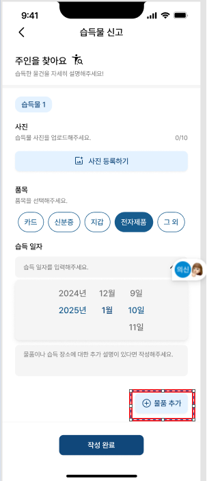
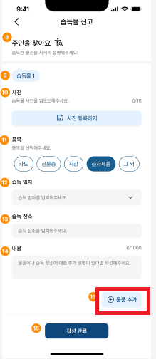

# 11-3.분실물_습득물신고_물품추가_클릭

원문 페이지 ID: 6b00221954bc827c856a0175553bf08c

> 누락 원본 복구 스냅샷. 원본의 과거값·검토 기록을 보존하며 생성 계약으로 자동 승인하지 않습니다.

대조 기록: [87개 원본 복구 및 8개 차이 정리](../recovery-review.md)

관련 기존 보관본: [11-3.분실물_습득물신고_물품추가_클릭](bb30221954bc83a0aba1015810eb5709.md), [11-3.분실물_습득물신고_물품추가_클릭](4890221954bc82ba95db01b93ecfeea0.md)

## 원문 속성

```json
{
  "platform": [
    "ANDROID",
    "IOS",
    "WEB"
  ],
  "url": "source-page-id:6b00221954bc827c856a0175553bf08c",
  "상태": "완료",
  "이름": "11-3.분실물\\_습득물신고\\_물품추가\\_클릭"
}
```

- 설명:   습득물 신고 글쓰기 페이지에서 물품 추가 클릭
- event\_label : “find\_user\_add\_item”
- value : “물품 추가”
- event\_category : “click”
- 참고사진





WEB Mobile View



