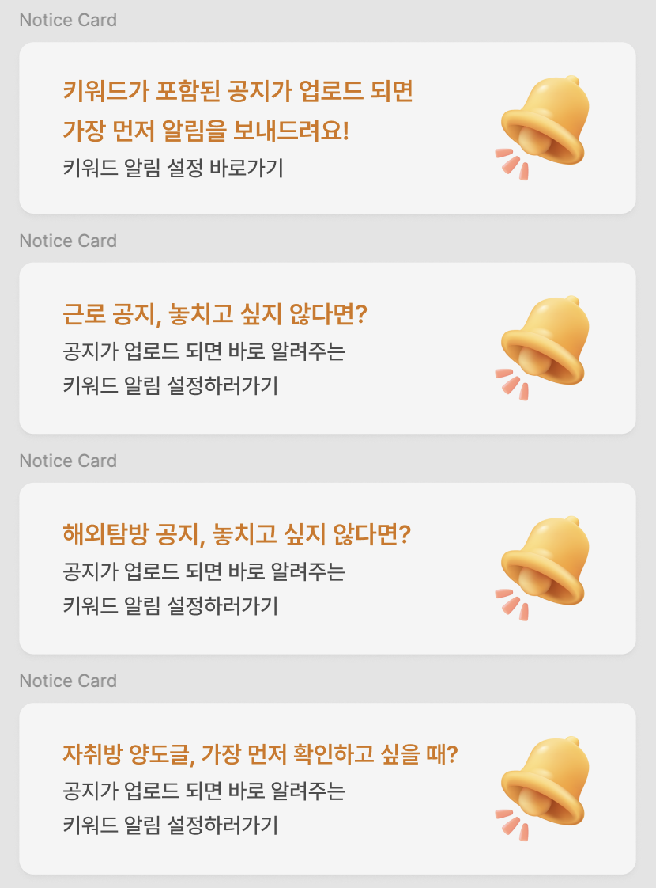

# 8-3. 키워드 관리 진입 배너_클릭

원문 페이지 ID: 6b50221954bc82b2bf970149e7a01455

> 사용자 제공 ZIP 내보내기 보관본. 레거시·동결·검토 상태는 원문을 따르며 코드 생성 승인·앱 배포 완료를 뜻하지 않습니다.

platform: ANDROID, IOS
상태: 완료

- 설명 : 메인 배너에서 키워드 알림설정 바로가기 (A/B테스트용)
    - 첫 배너에서 사용자당 업데이트 후 7일마다 변경됨
- event_label : “to_manage_keyword”
- value : “안내글”**, “근로”, “해외탐방”, “자취방 양도”**
- event_category : “click”
- 참고사진
    
    
