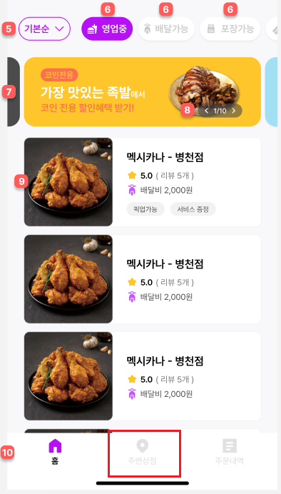

# 2-20 상점 카테고리 → 주변상점 - 레거시

원문 페이지 ID: 6b50221954bc838285ce819193a477b1

> 원문 스냅샷. 명세 확정·앱 배포·수집 완료를 뜻하지 않습니다.

## 원문 속성

```json
{
  "platform": [
    "ANDROID",
    "IOS"
  ],
  "url": "source-page-id:6b50221954bc838285ce819193a477b1",
  "상태": "로깅 필요",
  "생성일": "2026-11-12T05:07:36.302Z",
  "이벤트 이름": "2-20 상점 카테고리 → 주변상점 - 레거시",
  "태그": [
    "2. 상점 카테고리"
  ]
}
```

<details>
<summary>과거 로깅</summary>

- 앱 내 간편결제 주문이 불가능한 상점 페이지로 이동





<span color="orange">event\_params.key</span>

<ul>
<li>
event\_label : shop\_categories\_nearby
</li>
<li>
value :  \{카테고리\}
</li>
<li>
event\_category : click 
</li>
<li>
duration\_time : 이전 카테고리에서 현 카테고리로 이동하는 시간 
</li>
<li>
previous\_page : \{이전 카테고리\}
</li>
<li>
current\_page : \{현 카테고리\}
</li>
</ul>
</details>
