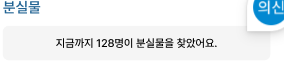
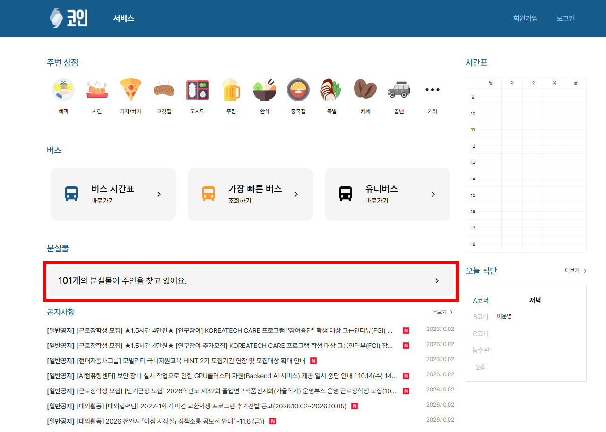
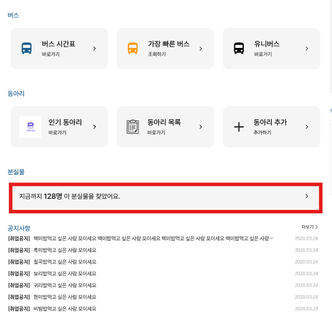

# 11-20.분실물_메인진입_클릭

원문 페이지 ID: 6c30221954bc82f98d29015150c37e2c

> 원문 스냅샷. 명세 확정·앱 배포·수집 완료를 뜻하지 않습니다.

## 원문 속성

```json
{
  "platform": [
    "WEB"
  ],
  "url": "source-page-id:6c30221954bc82f98d29015150c37e2c",
  "상태": "완료",
  "이름": "11-20.분실물\\_메인진입\\_클릭",
  "태그": [
    "11.분실물"
  ]
}
```

<details>
<summary>과거 로깅</summary>

- 설명: 메인화면에서 분실물로 진입하는 이벤트
- event\_label : lost\_item\_entry
- value : 분실물
- event\_category : click
- 참고사진




</details>

<details>
<summary>새 로깅</summary>

- 설명: 메인화면에서 분실물로 진입하는 이벤트
- screen\_view: <code>main</code>
- event\_name: <code>DA2</code>
- event\_label: <code>board__main__lost_item_entry__main_entry__click</code>
- value: 분실물
- event\_category: <code>click</code>

<b>참고사진 (기능 표시)</b>

<columns>
<column ratio="50">
<b>웹</b>

웹 — 메인 분실물 진입


</column>
<column ratio="50">
<b>모바일</b>

모바일 웹 — 메인 분실물 진입 (기존 로깅 캡처)


</column>
</columns>

- 사진 기준: 모바일 사진은 기존 모바일 웹 메인 캡처입니다. 앱의 카테고리 화면 진입은 11-21에서 별도로 표시합니다.
</details>
