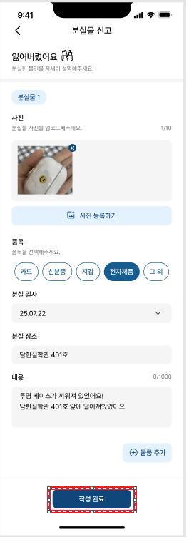

# 11-11.분실물_분실물신고_작성완료_클릭

원문 페이지 ID: 6c60221954bc82ee91c1010e8c3eee09

> 사용자 제공 ZIP 내보내기 보관본. 레거시·동결·검토 상태는 원문을 따르며 코드 생성 승인·앱 배포 완료를 뜻하지 않습니다.

platform: ANDROID, IOS, WEB
상태: 완료

- 설명:  습득물 신고 글쓰기 페이지에서 작성완료 클릭
- event_label : “lost_item_write_confirm”
- value : “작성 완료”
- event_category : “click”
- 참고사진

mobile_view, mobile_Web_view

WEB : 예시 화면이 습득물 신고인데 분실물 신고랑 기능이 동일해서 넣었습니다.

