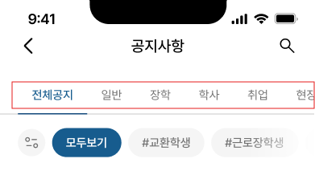

# 4-1. 탭 메뉴바_클릭

원문 페이지 ID: 6f80221954bc83aba7a6013fe9d9dfc3

> 누락 원본 복구 스냅샷. 원본의 과거값·검토 기록을 보존하며 생성 계약으로 자동 승인하지 않습니다.

대조 기록: [87개 원본 복구 및 8개 차이 정리](../recovery-review.md)

관련 기존 보관본: [4-1. 탭 메뉴바_클릭](52b0221954bc833bb32a018370533c49.md), [4-1. 탭 메뉴바_클릭](f380221954bc83319946015c7d177803.md)

## 원문 속성

```json
{
  "platform": [
    "ANDROID",
    "IOS"
  ],
  "url": "source-page-id:6f80221954bc83aba7a6013fe9d9dfc3",
  "상태": "완료",
  "이름": "4-1. 탭 메뉴바\\_클릭"
}
```




각 탭 명을 value값으로 추가

