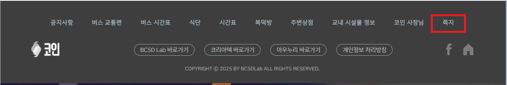

# 11-19.푸터_쪽지_클릭

원문 페이지 ID: 6ff0221954bc8234ad4c01b4aa129427

> 사용자 제공 ZIP 내보내기 보관본. 레거시·동결·검토 상태는 원문을 따르며 코드 생성 승인·앱 배포 완료를 뜻하지 않습니다.

platform: WEB
상태: 완료

- 설명:  웹 페이지 푸터 에서 쪽지 버튼 클릭
- event_label : “footer”
- value : “쪽지”
- event_category : “click”
- 참고사진

WEB

- 검토사항
    - 후속 수정 (2026-10-27): ※ 옛 사본: 현행 명세는 게시판 DB의 같은 번호 페이지 [11-19.푸터_쪽지_클릭](05d0221954bc82c8a85b8139b750cbb8.md). 이 사본은 새 로깅이 없어 변환하지 않음.
