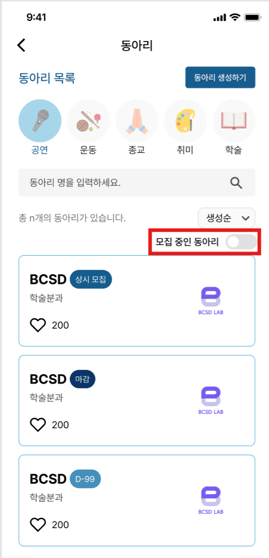
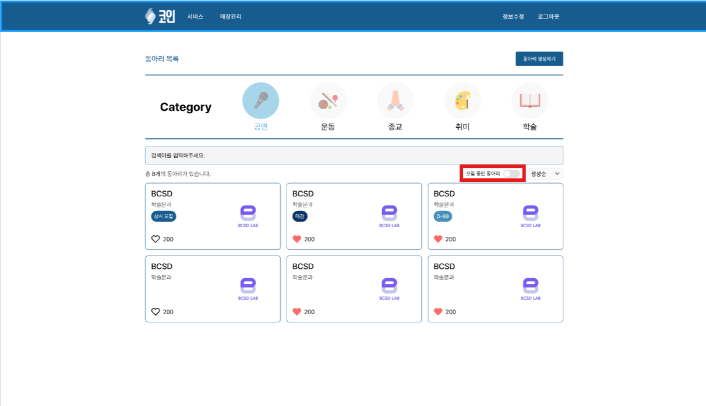

# 2.6 동아리_모집 중인 동아리 토글 클릭

원문 페이지 ID: 6ff0221954bc82c9ab4c017a32a7e391

> 사용자 제공 ZIP 내보내기 보관본. 레거시·동결·검토 상태는 원문을 따르며 코드 생성 승인·앱 배포 완료를 뜻하지 않습니다.

platform: ANDROID, IOS, WEB
상태: 로깅 필요

- 설명: 동아리 메인화면에서 모집 중인 동아리 토글 ON/OFF
- event_name : “CAMPUS”
- event_label : “club_main_recruiting_toggle”
- value : {on / off} // ‘on’ 또는 ‘off’ 값을 가지는 형태
- event_category : “click”
- 참고사진

- 웹 참고사진

