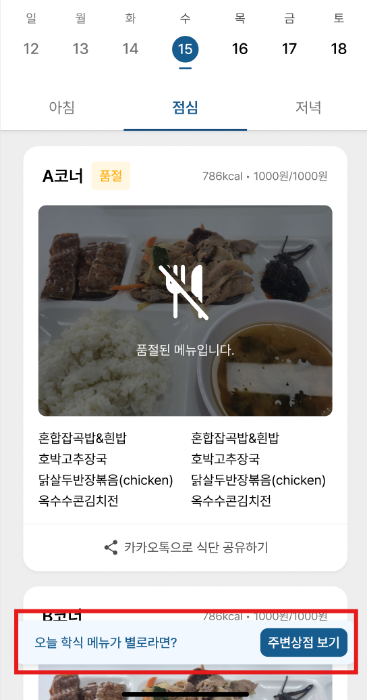
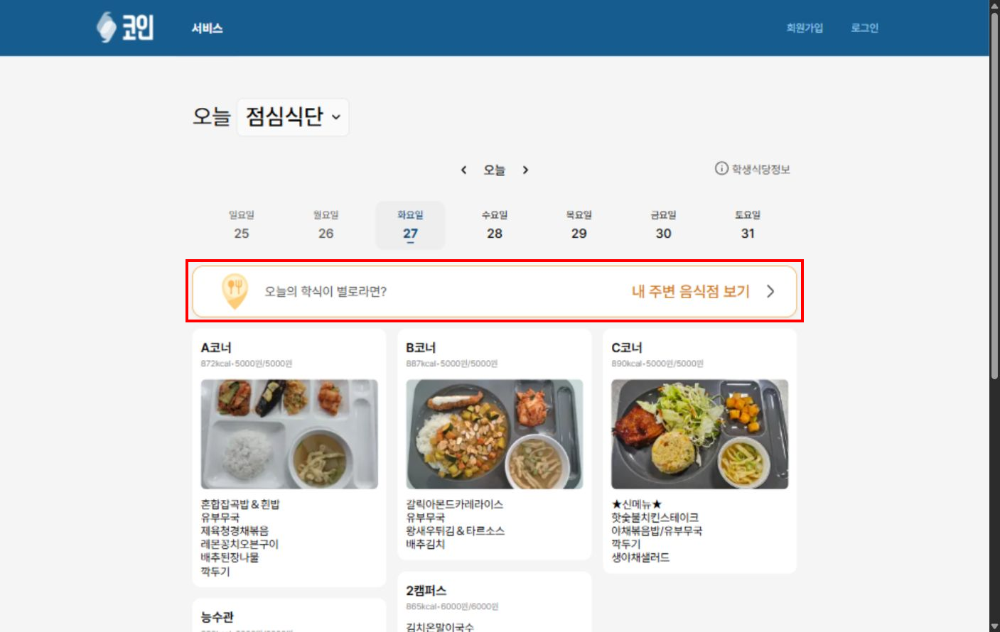
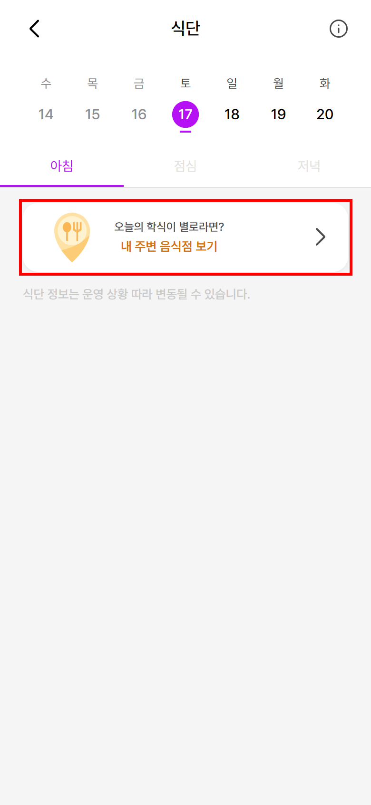

# 0-1. 식단_ABtest_상점가기_클릭

원문 페이지 ID: 7060221954bc83cbab80010bdc78c5f0

> 원문 스냅샷. 명세 확정·앱 배포·수집 완료를 뜻하지 않습니다.

## 원문 속성

```json
{
  "platform": [
    "ANDROID",
    "IOS",
    "WEB"
  ],
  "url": "source-page-id:7060221954bc83cbab80010bdc78c5f0",
  "상태": "완료",
  "생성일": "2026-11-08T10:51:37.014Z",
  "이름": "0-1. 식단\\_ABtest\\_상점가기\\_클릭",
  "태그": [
    "0. A/B TEST"
  ]
}
```

<details>
<summary>이전 로깅</summary>

- event\_label : “dining\_to\_shop”
- value : “\{아침 or 점심 or 저녁\}<b>”</b>
- event\_category : “click”
- 설명: 학식 화면에서 상점 화면으로 가는 버튼 클릭 시 발생하는 이벤트입니다.
- custom\_session\_id : \{dining2shop\}\_\{0\}\_\{플랫폼\}\_\{세션시작시간\}\_\{랜덤값\}
- 참고사진


</details>

<details>
<summary>새 로깅 (26.10.17)</summary>

- 설명: 식단 화면에서 상점가기 배너(오늘의 학식이 별로라면? 내 주변 음식점 보기)를 눌러 주변상점으로 이동하는 경우 (A/B 테스트, 주변상점으로 넘어가는 클릭이라 service는 shop)
- screen\_view: <code>cafeteria</code>
- event\_name: <code>DA1</code>
- event\_label: <code>shop__cafeteria__shop_banner__click</code>
- value: \{식사 시간\} → 아침 / 점심 / 저녁 (예: 점심)
- event\_category: <code>click</code>

<details>
<summary>검토사항</summary>

- 통합 가이드·후속: [로깅 통합 가이드](3c30221954bc8214b1c481c5bbb6fba5.md)
- 참고: custom\_session\_id는 과거 정의 그대로 유지
- 웹 참고사진 추가 완료 (stage 캡처에 빨간 네모, 2026-10-28)
</details>

### 참고사진 (상점가기 배너 클릭)

<columns>
<column ratio="50">
<b>웹</b>

<details>
<summary>참고사진 · 웹</summary>





WEB · 빨간 네모: 식단 상점가기 배너 클릭. stage 실제 화면 캡처에 위치 표시.

</details>
</column>
<column ratio="50">
<b>모바일</b>

<details>
<summary>참고사진 · 모바일</summary>

모바일 — 상점가기 배너 클릭 (출처: stage 실제 캡처, 빨간 네모 = 클릭 위치)


</details>
</column>
</columns>
</details>
