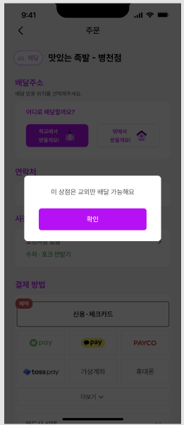

# 7-17 결제 페이지 결제 실패 (교외만 배달 가능, 6월 29일 수정)

원문 페이지 ID: 7240221954bc825a9bb481a4837514e9

> 원문 스냅샷. 명세 확정·앱 배포·수집 완료를 뜻하지 않습니다.

## 원문 속성

```json
{
  "platform": [
    "WEB"
  ],
  "url": "source-page-id:7240221954bc825a9bb481a4837514e9",
  "상태": "로깅 필요",
  "생성일": "2026-11-08T10:51:55.987Z",
  "이벤트 이름": "7-17 결제 페이지 결제 실패 (교외만 배달 가능, 6월 29일 수정)"
}
```




결제 페이지에서 결제에 실패하여 해당 확인 버튼 클릭 로깅입니다<br />

event\_params.key

<ul>
<li>
event\_label : payment\_delievery\_only\_campus\_off
</li>
<li>
value : 

- \{상점이름\}
</li>
<li>
event\_category :

- click
</li>
</ul>
