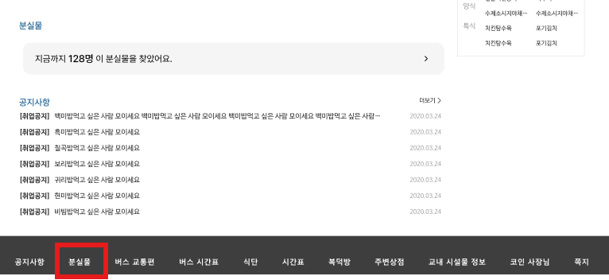
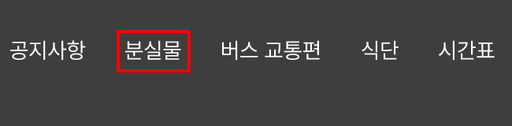
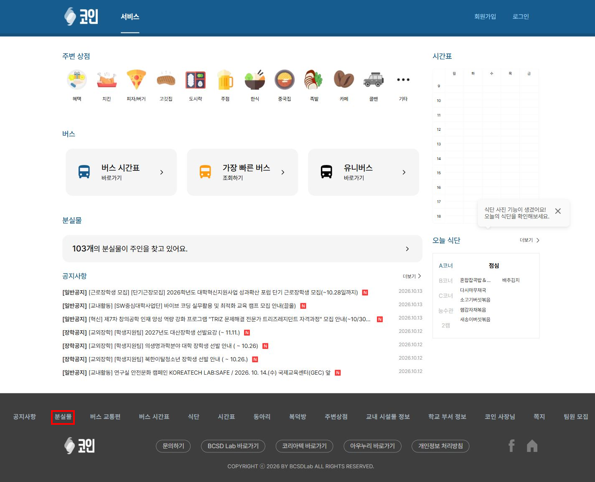

# 11-31. 푸터_분실물_클릭

원문 페이지 ID: 7280221954bc821a93ca0157ac254c15

> 원문 스냅샷. 명세 확정·앱 배포·수집 완료를 뜻하지 않습니다.

## 원문 속성

```json
{
  "platform": [
    "WEB"
  ],
  "url": "source-page-id:7280221954bc821a93ca0157ac254c15",
  "상태": "완료",
  "이름": "11-31. 푸터\\_분실물\\_클릭",
  "태그": [
    "11.분실물"
  ]
}
```

<details>
<summary>이전 로깅</summary>

<ul>
<li>
설명: 푸터의 분실물 클릭시 발생하는 로그입니다. 
</li>
<li>
event\_label : footer
</li>
<li>
value : 분실물
</li>
<li>
event\_category : click
</li>
<li>
참고사진
</li>
</ul>


</details>

<details>
<summary>새 로깅 (26.10.12) — 초안</summary>

- 설명: 푸터의 분실물 클릭시 발생하는 로그입니다.
- screen\_view: <code>footer</code>
- event\_name: <code>DA2</code>
- event\_label: <code>board__footer__lost_item_entry__footer_entry__click</code>
- value: 분실물
- event\_category: <code>click</code>

<details>
<summary>검토사항</summary>

- screen\_view 확정 (2026-10-30 상민 직접 지시): event\_label의 두 번째 구간과 같은 <code>footer</code> 고정값을 사용한다. 이전 동적 화면명 표기안은 이 결정으로 대체한다. 라벨·category·value·발생 시점·플랫폼·사진은 유지하며 SDK 적용·실제 전송·한 번 전송은 미확인이다.
- label 통일 (2026-10-27): <code>board__footer__lost_item_entry__footer_entry</code> → <code>board__footer__lost_item_entry__footer_entry__click</code>
</details>

### 참고사진 (WEB 리디자인 · 푸터 분실물)

<b>웹</b>

<details>
<summary>참고사진 · 웹</summary>

[Figma 원본](https://www.figma.com/design/DPlcYuiFxhyT5ULbqec59i/KOIN-Web?node-id=17664-28870) · 2026-11-04. 원본 캡처에 빨간 네모만 추가했다. 빨간 네모는 기존 명세의 분실물 클릭 위치다. 실제 SDK 적용·배포·전송은 미확인이다.


<b>클릭 위치 확대</b>


</details>

<b>기존 참고사진 (과거 디자인·원문 보존)</b>

### 참고사진 (기능 표시)

<columns>
<column ratio="50">
<b>웹</b>

<details>
<summary>참고사진 · 웹</summary>

실제 데스크톱 웹 캡처(2026-10-13)에 해당 푸터 메뉴의 빨간 테두리만 표시했다.


</details>
</column>
<column ratio="50">
<b>모바일</b>

이 항목은 웹 전용 헤더·푸터 로깅입니다.
</column>
</columns>
</details>
