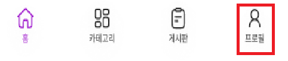

# 2-4 네비게이션 바 프로필 클릭

원문 페이지 ID: 74b0221954bc827d9464015922a7ca19

> 원문 스냅샷. 명세 확정·앱 배포·수집 완료를 뜻하지 않습니다.

## 원문 속성

```json
{
  "platform": [
    "ANDROID",
    "IOS",
    "WEB"
  ],
  "url": "source-page-id:74b0221954bc827d9464015922a7ca19",
  "구분": "네비게이션 바",
  "상태": "완료",
  "생성일": "2026-11-08T10:52:04.160Z",
  "이벤트 이름": "2-4 네비게이션 바 프로필 클릭"
}
```

- event\_label : nav\_profile
- value : 프로필
- event\_category : click





<details>
<summary>새 로깅 (26.11.01)</summary>

<b>프로필</b>

- 설명: 공용 하단 네비게이션 바에서 프로필 항목을 클릭할 때 기록한다. 프로필 화면 안의 로그인·로그아웃 클릭과 구분한다.
- screen\_view: <code>main</code>
- event\_name: <code>DA2</code>
- event\_label: <code>main__main__navigation__profile_entry__click</code>
- value: 프로필
- event\_category: <code>click</code>

<details>
<summary>검토사항</summary>

- WEB 리디자인 반영 (2026-11-04 사용자 승인): WEB 리디자인 프레임에는 하단 프로필 탭이 없다. 이 하단 내비게이션 명세는 해당 WEB 리디자인 적용 대상에서 제외한다. ANDROID·IOS의 기존 새 명세는 유지하며, 헤더 로그인·회원가입에 이 라벨을 재사용하지 않는다.
- WEB 설계 근거: [Figma 참고 / 실제 화면 미확인](https://www.figma.com/design/DPlcYuiFxhyT5ULbqec59i/KOIN-Web?node-id=11541-33352). 기존 사진은 교체하지 않았으며 리디자인 화면의 위치 근거로 사용하지 않는다. SDK 구현·배포 시점·실제 수집은 미확인이다. 이 WEB 규정은 해당 화면의 과거 WEB 설명보다 우선하며 모바일·이전 로깅·기존 필드 값·DB 플랫폼 속성은 보존한다.
- 사용자 승인 (2026-11-01): 기존 동작을 공통 네이밍 형식으로 정리하고 새 명세의 event\_name을 DA2로 통일했다. 기존 CAMPUS 지시와 과거 label·value·category·사진은 위 원문에 보존한다. 새 사용자 동작이나 추가 전송을 만드는 작업이 아니다.
- 이전 → 새 label: <code>nav_profile</code> → <code>main__main__navigation__profile_entry__click</code>.
- 기존 click category·고정 value·선택값 의미·클릭 시점을 유지한다. 기존 DB 플랫폼 속성을 보존했으며, 실제 지원 플랫폼·SDK 적용·배포·한 번 전송은 미확인이다.
- 공용 알림·하단 네비게이션의 service는 main이다. 담당자 event\_name DA2와 구분한다.
- 참고사진은 위 기존 사진을 그대로 참조한다. 이 작업에서 촬영·교체·플랫폼 재분류하지 않았다.
- 기준: [로깅 통합 가이드](3c30221954bc8214b1c481c5bbb6fba5.md), [event_label 기능·행동 네이밍 사전](38b0221954bc831b912c012d8af2c857.md), [화면 정의 및 로깅 검수](0e40221954bc823d92c301f83b5f68d0.md).
</details>
</details>
