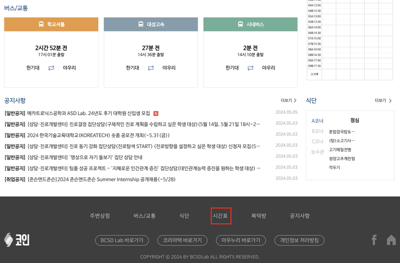

# 2-4. (웹) 푸터_시간표

원문 페이지 ID: 74d0221954bc831ab22401fb98eb62fc

> 원문 스냅샷. 명세 확정·앱 배포·수집 완료를 뜻하지 않습니다.

## 원문 속성

```json
{
  "platform": [
    "WEB"
  ],
  "url": "source-page-id:74d0221954bc831ab22401fb98eb62fc",
  "상태": "완료",
  "생성일": "2026-11-12T05:08:09.058Z",
  "이벤트 이름": "2-4. (웹) 푸터\\_시간표",
  "태그": [
    "시간표"
  ]
}
```

<details>
<summary>과거 로깅</summary>

- event\_label : “footer”
- value : “시간표”
- event\_category : “click”
- 참고 이미지


</details>

<details>
<summary>새 로깅</summary>

- 설명: 웹 하단 푸터의 서비스 링크에서 시간표를 클릭해 시간표 화면으로 들어가는 경우
- screen\_view: <code>footer</code>
- event\_name: <code>DA1</code>
- event\_label: <code>timetable__footer__timetable_entry__footer_entry__click</code>
- value: 시간표
- event\_category: <code>click</code>

### 참고사진 (WEB 리디자인 · 푸터 시간표)

<b>웹</b>

<b>참고사진 · 웹</b>

[Figma 원본](https://www.figma.com/design/DPlcYuiFxhyT5ULbqec59i/KOIN-Web?node-id=17664-28870) · 2026-11-04. 원본 캡처에 빨간 네모만 추가했다. 빨간 네모는 기존 명세의 시간표 클릭 위치다. 실제 SDK 적용·배포·전송은 미확인이다.


</details>
