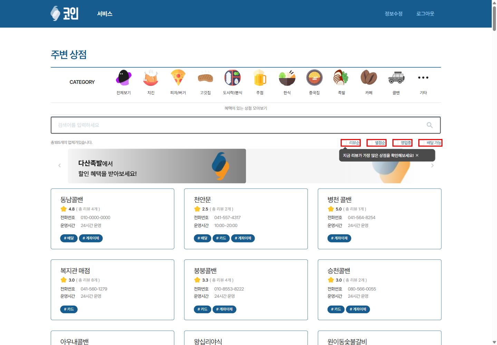

# 2-5~8 상점 카테고리 토글 

원문 페이지 ID: 75e0221954bc8290a3ac01e029e0a59c

> 원문 스냅샷. 명세 확정·앱 배포·수집 완료를 뜻하지 않습니다.

## 원문 속성

```json
{
  "platform": [
    "WEB",
    "ANDROID",
    "IOS"
  ],
  "url": "source-page-id:75e0221954bc8290a3ac01e029e0a59c",
  "상태": "완료",
  "생성일": "2026-11-08T10:51:48.978Z",
  "이벤트 이름": "<p>\n2-5\\~8 상점 카테고리 토글 \n</p>",
  "태그": [
    "2. 상점 카테고리"
  ]
}
```

<details>
<summary>이전 로깅</summary>

<span color="orange">event\_params.key</span>

<ul>
<li>
event\_label : shop\_can
</li>
<li>
value : 

- check\_delivery\_\{카테고리\}
- check\_review\_\{카테고리\}
- check\_star\_\{카테고리\}
- check\_open\_\{카테고리\}
</li>
<li>
event\_category : click 
</li>
</ul>


---

상점카테고리에서 토글을 클릭하는 횟수를 파악하고자 하는 이벤트 입니다.


<p>
현재 웹만 존재하는 상황. 
</p>


<p>
→ 체크 되었을때만 이벤트를 카운트 해주시면 됩니다. 
</p>

---

<h3>
오류 사항 
</h3>

[해결 (1)](5330221954bc8207bf0c01c26c46f23d.md)
</details>

<details>
<summary>새 로깅 (26.10.17)</summary>

- 설명: 상점 목록 화면에서 배달·리뷰·별점·영업중 체크박스가 해제 상태에서 선택 상태로 바뀔 때 1회 기록한다. 선택 해제에는 기록하지 않는다.
- screen\_view: <code>shop_list</code>
- event\_name: <code>DA1</code>
- event\_label: <code>shop__shop_list__filter__checkbox__select</code>
- value: \{켠 필터\} → 배달 / 리뷰 / 별점 / 영업중 (예: 영업중)
- event\_category: <code>select</code>

<details>
<summary>검토사항</summary>

- 필터 발생 조건 정리 (2026-11-05): 이 checkbox 라벨은 체크박스 UI의 해제→선택 전환에만 1회 적용한다. 동일 동작에 quick\_filter 라벨을 함께 보내지 않는다. DB platform은 유지하며 실제 UI별 호출 매핑으로 구분한다. 대응 명세: [2-13 ~ 17 상점 카테고리 필터](8730221954bc82a38e6b8105fa07523a.md).
- SDK 수정 필요 (2026-11-05): 확인한 WEB 기본 브랜치는 체크·해제 양쪽에서 옛 shop\_can을 전송한다. 기존 승인 조건인 선택 시점에 맞춰 개발 반영이 필요하다. 명세를 현재 코드의 해제 전송에 맞춰 바꾸지 않는다. 근거: [WEB 체크박스 핸들러](https://github.com/BCSDLab/KOIN_WEB_RECODE/blob/13f1a5d3c315a913b32b51a87e6700ea5b12d8d4/src/pages/store/index.tsx#L211). 운영 배포 버전·수정 후 한 번 전송은 미확인이다.
- 이전 검토 기록 (아래 현재 기준으로 대체) (2026-11-04): 이 체크박스 계약과 대응 퀵필터 계약의 PC WEB·모바일웹·네이티브 UI 및 platform 적용 범위를 확인해야 한다. 동일 영업중 켜기 동작에서 문서 수만큼 두 라벨을 함께 보내지 않는다. 기존 label·value·category·DB platform은 유지하며 사진만으로 네이티브 기능 유무를 확정하지 않는다. 대응 명세: [2-13 ~ 17 상점 카테고리 필터](8730221954bc82a38e6b8105fa07523a.md).
- 사진 재검수 (2026-10-30): 근거 없이 웹 전용으로 단정하던 모바일 안내를 수정했다. WEB 사진을 최신 실제 캡처로 교체했다. platform 속성·라벨·value는 유지하며 네이티브 지원 여부는 미확인이다.
- 통합 가이드: [로깅 통합 가이드](3c30221954bc8214b1c481c5bbb6fba5.md)
- label DA2 기준 정렬 (2026-10-27): <code>shop__shop_list__filter__select</code> → <code>shop__shop_list__filter__checkbox__select</code>
</details>

### 참고사진 (상점 목록 필터 체크)

<columns>
<column ratio="50">
<b>웹</b>

<details>
<summary>참고사진 · 웹</summary>





WEB · stage 실제 리뷰순·별점순·영업중·배달 가능 체크박스. 빨간 테두리=필터들. 2026-10-30.

</details>
</column>
<column ratio="50">
<b>모바일</b>

<details>
<summary>참고사진 · 모바일</summary>

없음
</details>
</column>
</columns>
</details>
