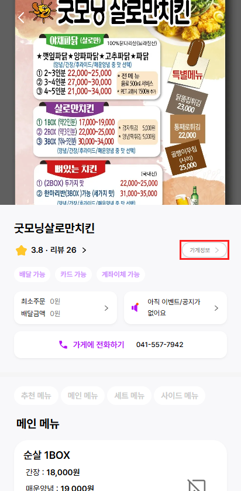

# 3-26 상점상세 가게정보 진입 (클릭)

원문 페이지 ID: 76e0221954bc83e49c83013b5d58d686

> 원문 스냅샷. 명세 확정·앱 배포·수집 완료를 뜻하지 않습니다.

## 원문 속성

```json
{
  "platform": [
    "IOS",
    "ANDROID"
  ],
  "url": "source-page-id:76e0221954bc83e49c83013b5d58d686",
  "상태": "로깅 필요",
  "생성일": "2026-11-12T05:07:35.099Z",
  "이벤트 이름": "3-26 상점상세 가게정보 진입 (클릭)",
  "태그": [
    "3. 상점 상세 페이지"
  ]
}
```

<details>
<summary>과거 로깅</summary>

- event\_label: <code>shop_detail_view_info</code>
- value: \{상점이름\}
- event\_category: click
</details>

<details>
<summary>새 로깅</summary>

- 설명: 상점 상세에서 가게정보 더보기 또는 최소주문금액·배달요금 영역을 눌러 가게정보 화면으로 진입할 때 기록한다.
- screen\_view: <code>shop_detail</code>
- event\_name: <code>DA1</code>
- event\_label: <code>shop__shop_detail__shop_info__entry__click</code>
- value: \{상점이름\}
- event\_category: <code>click</code>

### 참고사진

<columns>
<column ratio="50">
<b>웹</b>

PC 웹: 가게정보를 상세 화면에 바로 표시하며 별도 진입 버튼 없음.
</column>
<column ratio="50">
<b>모바일</b>





Stage 모바일 웹 · 가게정보 진입 버튼

</column>
</columns>
</details>
