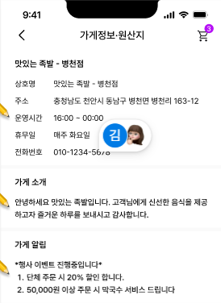

# 3-8 상점상세 가게정보 카트 클릭

원문 페이지 ID: 76f0221954bc827ea9ac01243fb5e40c

> 원문 스냅샷. 명세 확정·앱 배포·수집 완료를 뜻하지 않습니다.

## 원문 속성

```json
{
  "platform": [
    "ANDROID",
    "IOS"
  ],
  "url": "source-page-id:76f0221954bc827ea9ac01243fb5e40c",
  "상태": "로깅 필요",
  "생성일": "2026-11-12T05:07:45.071Z",
  "이벤트 이름": "3-8 상점상세 가게정보 카트 클릭",
  "태그": [
    "3. 상점 상세 페이지"
  ]
}
```




<p>
상점상세 화면에서 가게 정보 확인 버튼을 누르고 카트에 진입하는 로깅입니다. 
</p>


<span color="orange">event\_params.key</span>

<ul>
<li>
event\_label : shop\_detail\_view\_info\_cart
</li>
<li>
value : \{상점이름\} 
</li>
<li>
event\_category : 

<ul>
<li>
click 
</li>
</ul>
</li>
</ul>
