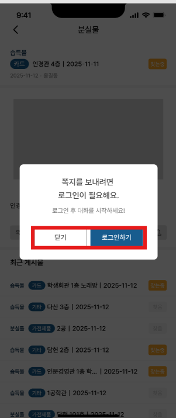
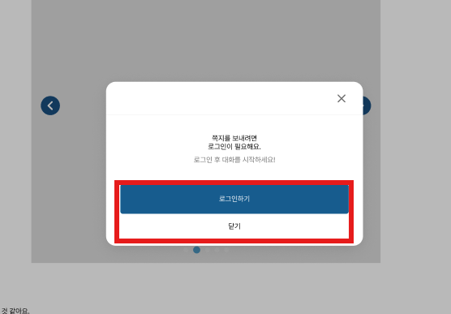
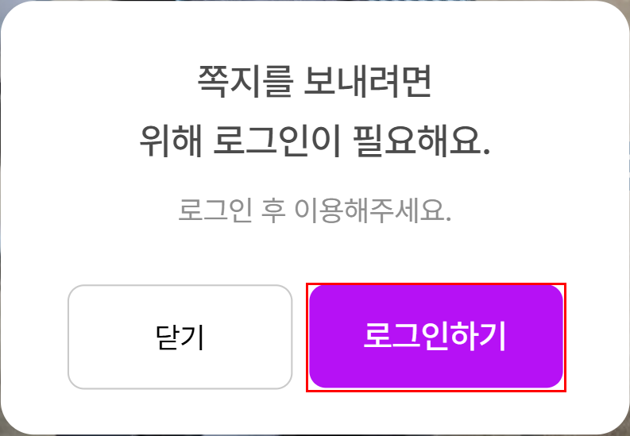

# 11-25. 분실물_쪽지_로그인요청_클릭

원문 페이지 ID: 7750221954bc82f8bdb881104b19b161

> 원문 스냅샷. 명세 확정·앱 배포·수집 완료를 뜻하지 않습니다.

## 원문 속성

```json
{
  "platform": [
    "ANDROID",
    "IOS",
    "WEB"
  ],
  "url": "source-page-id:7750221954bc82f8bdb881104b19b161",
  "상태": "완료",
  "이름": "11-25. 분실물\\_쪽지\\_로그인요청\\_클릭",
  "태그": [
    "11.분실물"
  ]
}
```

<details>
<summary>이전 로깅</summary>

- 설명: 로그인 요청 모달에서 ‘닫기’ 혹은 ‘로그인하기’ 버튼 중 클릭하는 버튼에 따라 ‘value’를 달리 해주시면 될 것 같습니다
- event\_label : lost\_item\_message\_login\_request
- value : ‘닫기’ or ‘로그인하기’
- event\_category : click
- 참고사진




</details>

<details>
<summary>새 로깅 (26.10.12) — 초안</summary>

- 설명: 쪽지 보내기에서 표시된 로그인 요청 팝업의 닫기 또는 로그인하기 버튼을 클릭.
- screen\_view: <code>lost_item_detail</code>
- event\_name: <code>DA2</code>
- event\_label:
  - 로그인하기 응답: <code>account__lost_item_detail__login_popup__login_entry__click</code>
  - 닫기 응답: <code>account__lost_item_detail__login_popup__close__click</code>
- value: 닫기 / 로그인하기
- event\_category: <code>click</code>

<details>
<summary>검토사항</summary>

- 모바일 웹 실화면 확인 (2026-10-30): 운영 분실물 상세에서 비로그인 쪽지 요청을 눌러 로그인 안내를 확인했다. 개인 게시물 배경을 제외하고 안내창 부분만 촬영했다. 로그인·쪽지 전송·게시물 수정은 수행하지 않았다. SDK 수집은 별도 확인 대상이다.
- 통합 가이드·후속: [로깅 통합 가이드](3c30221954bc8214b1c481c5bbb6fba5.md)
- label 통일 (2026-10-27): <code>account__lost_item_detail__login_popup__login_entry</code> → <code>...__login_entry__click</code>, <code>account__lost_item_detail__login_popup__close</code> → <code>...__close__click</code>
- 로그인 안내 팝업은 login\_popup 기능으로 통일한다. 실제 누른 버튼에 해당하는 label 하나만 전송한다. 기존 value와 category, 클릭 시점은 유지하며 추가 전송을 만들지 않는다.
</details>

### 참고사진 (기능 표시)

<columns>
<column ratio="50">
<b>웹</b>

<details>
<summary>참고사진 · 웹</summary>

웹 — 쪽지 로그인 요청의 로그인하기·닫기 (기존 로깅 캡처)


</details>
</column>
<column ratio="50">
<b>모바일</b>

<details>
<summary>참고사진 · 모바일</summary>





모바일 웹 · 실제 운영 분실물에서 쪽지 보내기를 눌러 열린 보라색 로그인 안내. 빨간 테두리=로그인하기. 게시물의 이름·사진·본문이 포함되지 않도록 안내창 부분만 실제 캡처했다. 실제 표시 문구를 수정하지 않았다. 네이티브 앱·SDK 검증과 구분.


모바일 — 쪽지 로그인 요청의 로그인하기·닫기 (기존 로깅 캡처)

구버전 사진을 제거하고 현재 보라색 모바일 웹의 실제 쪽지 로그인 안내로 보완했다.
</details>
</column>
</columns>
</details>
