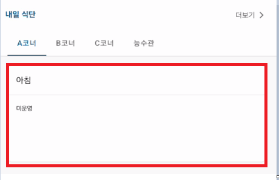
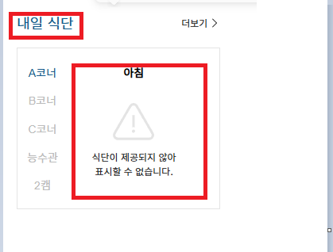
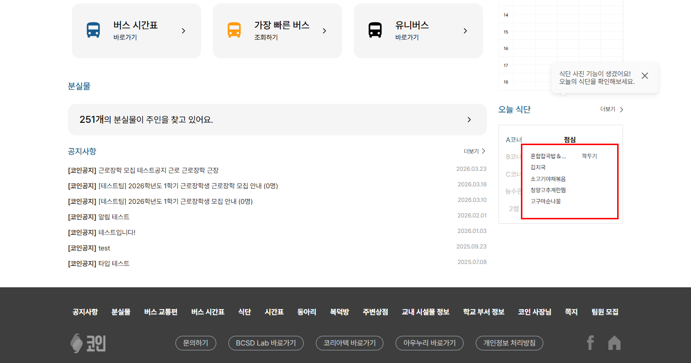
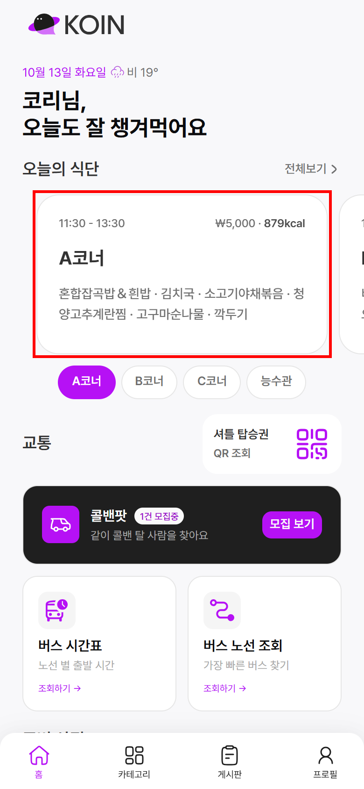

# 1-2.메인_식단_클릭

원문 페이지 ID: 77e0221954bc82b7b9030139d648368f

> 누락 원본 복구 스냅샷. 원본의 과거값·검토 기록을 보존하며 생성 계약으로 자동 승인하지 않습니다.

대조 기록: [87개 원본 복구 및 8개 차이 정리](../recovery-review.md)

관련 기존 보관본: [1-2.메인_식단_클릭 (레거시)](5a80221954bc8265a92e01bcddeea491.md), [레거시 메인_식단_더보기버튼_클릭(확인필요)](3d50221954bc8228a8ed81c51f8aa5d6.md), [레거시 1-14. 메인_버스_클릭](f450221954bc8321ab2e8140e800c375.md), [1-11. 셔틀 탑승권_클릭 (레거시)](1e10221954bc8268a989013ec93c6966.md)

## 원문 속성

```json
{
  "platform": [
    "ANDROID",
    "IOS",
    "WEB"
  ],
  "url": "source-page-id:77e0221954bc82b7b9030139d648368f",
  "상태": "완료",
  "생성일": "2026-11-08T10:51:34.399Z",
  "이름": "1-2.메인\\_식단\\_클릭",
  "태그": [
    "1. 메인_식단"
  ]
}
```

<details>
<summary>이전 로깅</summary>


- 설명 : 메인화면에서 식단 칸 클릭
- event\_label : “main\_menu\_moveDetailView”
- value : “오늘 식단, 내일 식단<b>”</b>
- event\_category : “click”
- 참고사진





- 웹
- 웹은 내일 식단 버튼 부분 포함





</details>


<details>
<summary>새 로깅 (26.10.17)</summary>


- 설명: 홈의 일반 식단 카드 본문을 눌러 식단 페이지로 진입할 때 기록한다. 전체보기·더보기 버튼, 코너 선택, 카드 단순 노출은 포함하지 않는다. 구 WEB의 오늘·내일 식단 제목 버튼과 iOS 빈 상태 안내 카드는 검토사항의 별도 경로를 따른다.
- screen\_view: <code>main</code>
- event\_name: <code>DA1</code>
- event\_label: <code>cafeteria__main__meal__click</code>
- value: 아침 / 점심 / 저녁 (예: 점심)
- event\_category: <code>click</code>

<details>
<summary>검토사항</summary>


- 클릭 영역 검증 (2026-11-05): 일반 식단 카드 본문은 홈 1-3 [1-3 오늘의 식단 전체보기 클릭](2430221954bc839da344811d15eaa112.md)의 전체보기·더보기와 다른 클릭이다. 따라서 이 카드 본문 명세는 레거시로 전환하지 않고 별개 유지한다. 같은 탭에 meal·more 두 라벨을 함께 보내지 않는다. 기존 label·value·category·event\_name·screen\_view·플랫폼·이전 로깅·사진은 보존한다.
- SDK 명시 로그 누락 후보: 확인한 새 Android DiningPager → HomeScreen onCardClick, iOS onTapMenu, 모바일웹 MealCard의 일반 카드 본문 경로는 화면 이동은 있으나 해당 핸들러에 클릭 로그 호출이 없다. 전역 계측·설치 버전·운영 배포까지 증명한 것은 아니며 실기기 네트워크 검증이 필요하다. 근거: [Android](https://github.com/BCSDLab/KOIN_ANDROID/blob/ee67a50f554030a76cfb7d8948b89d8efc806e9d/feature/home/src/main/java/in/koreatech/koin/feature/home/HomeScreen.kt#L227), [iOS](https://github.com/BCSDLab/KOIN_iOS/blob/f9286701b52668451840aa4b3432a3bcc8bd7aa8/Koin/Presentation/Home/Home/HomeView.swift#L60), [모바일웹](https://github.com/BCSDLab/KOIN_WEB_RECODE/blob/13f1a5d3c315a913b32b51a87e6700ea5b12d8d4/src/components/IndexComponents/IndexMobileCafeteria/index.tsx#L31).
- 구 WEB 공용 핸들러 주의: IndexCafeteria의 식단 제목·더보기·일반 카드 본문은 모두 handleMoreClick을 호출하고 옛 main\_menu\_moveDetailView 하나로 전송한다. 옛 라벨 문자열만으로 새 meal 또는 more를 일괄 매핑하면 실제 클릭 영역이 섞인다. 기존 오늘·내일 제목 버튼은 이 구 WEB 경로의 이력으로 유지하고 새 시안에 임의 적용하지 않는다. [공용 핸들러](https://github.com/BCSDLab/KOIN_WEB_RECODE/blob/13f1a5d3c315a913b32b51a87e6700ea5b12d8d4/src/components/IndexComponents/IndexCafeteria/index.tsx#L43).
- 옛 Android 위젯 주의: 남아 있는 DiningWidget 소스는 LaunchedEffect(Unit)에서 main\_menu\_moveDetailView를 click으로 기록한다. 클릭이 아닌 구성 진입 시점 코드이므로 CTR 근거로 바로 쓰지 않는다. 검색에서 선언·Preview 외 활성 호출은 확인하지 못했으며 운영 버전에서 사용되는지는 미확인이다. [옛 컴포넌트](https://github.com/BCSDLab/KOIN_ANDROID/blob/ee67a50f554030a76cfb7d8948b89d8efc806e9d/koin/src/main/java/in/koreatech/koin/ui/main/widget/DiningWidget.kt#L81).
- 홈 식단 클릭 영역 중복 후보 (2026-11-05): 홈 1-3 [1-3 오늘의 식단 전체보기 클릭](2430221954bc839da344811d15eaa112.md)의 모바일 식단 위젯 설명과 이 페이지의 식단 칸 클릭이 겹칠 수 있다. 전체보기·더보기 버튼과 카드 본문·내일 식단 버튼을 구분하며 같은 탭에 두 새 라벨을 동시에 적용하지 않는다. WEB 리디자인 전체보기는 홈 1-3을 따르고 이 meal 라벨을 함께 보내지 않는다. Android/iOS 카드 본문과 전체보기의 실제 호출 경계는 미확인이므로 확인 전 기존 앱 발생 조건을 임의로 바꾸거나 추가 전송하지 않는다. 라벨·value·category·이전 로깅·사진·플랫폼은 유지한다.
- 통합 가이드·후속: [로깅 통합 가이드](3c30221954bc8214b1c481c5bbb6fba5.md)
- 클릭 영역: 웹은 식단 칸 + 내일 식단 버튼 포함, 모바일은 식단 칸

</details>


### 참고사진 (메인 식단 칸 클릭)


<b>웹</b>

<details>
<summary>참고사진 · 웹</summary>


웹 — 메인 식단 칸 클릭 (출처: stage 실제 캡처, 빨간 네모 = 클릭 위치)





</details>


<b>모바일</b>

<details>
<summary>참고사진 · 모바일</summary>


모바일 — 메인 식단 칸 클릭 (출처: stage 실제 캡처, 빨간 네모 = 클릭 위치)





</details>


</details>
