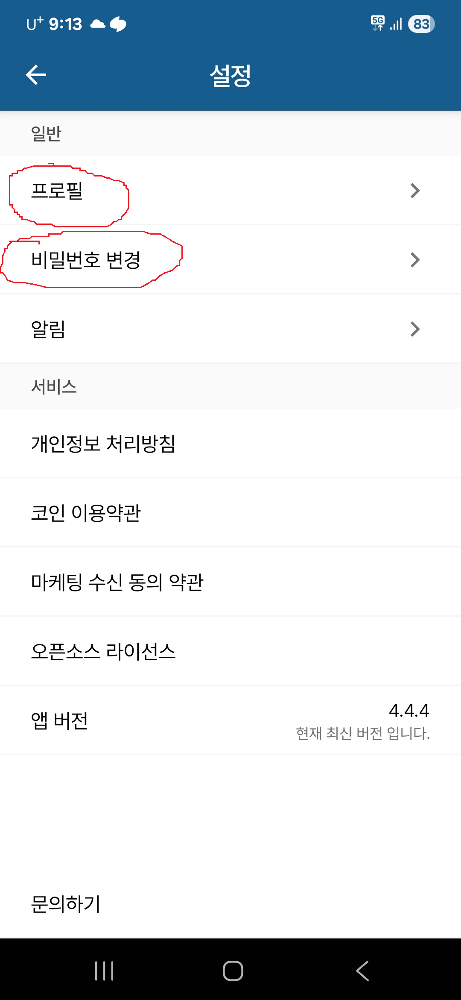
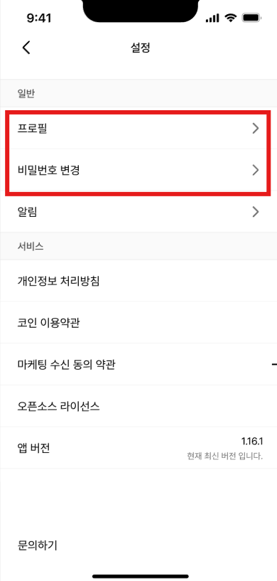

# 3-2 정보수정하기(클릭)

원문 페이지 ID: 7900221954bc822a8e2c815c99a410d2

> 원문 스냅샷. 명세 확정·앱 배포·수집 완료를 뜻하지 않습니다.

## 원문 속성

```json
{
  "platform": [
    "ANDROID",
    "IOS"
  ],
  "url": "source-page-id:7900221954bc822a8e2c815c99a410d2",
  "구분": "정보수정",
  "상태": "로깅 필요",
  "생성일": "2026-11-12T05:07:32.107Z",
  "이벤트 이름": "3-2 정보수정하기(클릭)",
  "태그": [
    "정보수정"
  ]
}
```

<details>
<summary>과거 로깅</summary>

- event\_label : “hamburger”
- value : “정보수정 시도<b>”</b>
- event\_category : “click”

모바일


</details>

<details>
<summary>새 로깅</summary>

- 설명: 계정 설정 화면에서 정보수정하기를 클릭해 정보수정 화면으로 진입할 때 기록한다.
- event\_name: <code>DA2</code>
- screen\_view: <code>account_config</code>
- event\_label: <code>account__account_config__profile_edit__entry__click</code>
- value: 정보수정 시도
- event\_category: <code>click</code>

<b>참고사진 · 모바일</b>

<b>모바일</b>


</details>
