# 7-1-1. 프로필 수정하기 내부

원문 페이지 ID: 7930221954bc83a7a54281ea4fb1fc42

> 원문 스냅샷. 명세 확정·앱 배포·수집 완료를 뜻하지 않습니다.

## 원문 속성

```json
{
  "platform": [
    "WEB",
    "ANDROID",
    "IOS"
  ],
  "url": "source-page-id:7930221954bc83a7a54281ea4fb1fc42",
  "구분": "프로필",
  "상태": "로깅 필요",
  "생성일": "2026-11-12T05:08:08.976Z",
  "이벤트 이름": "7-1-1. 프로필 수정하기 내부"
}
```

<details>
<summary>과거 로깅</summary>

① 회원정보 불러오기

- event\_label : team\_recruitment\_profile\_modify\_load
- value : 회원정보 불러오기
- event\_category : click

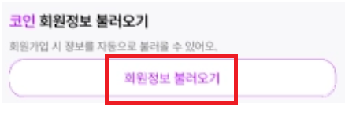

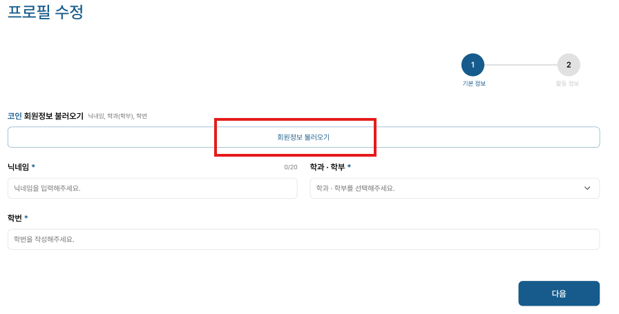

② 학과·학부 선택

- event\_label : team\_recruitment\_profile\_modify\_major\_select
- value : 사용자가 선택한 학부로 해주세요
- event\_category : click

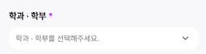

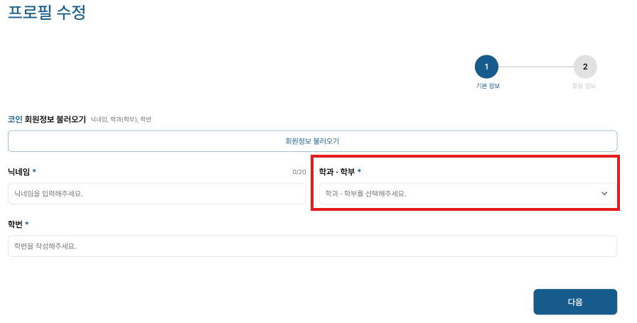

③ 다음 버튼 클릭

- event\_label : team\_recruitment\_profile\_modify\_next
- value : 다음
- event\_category : click

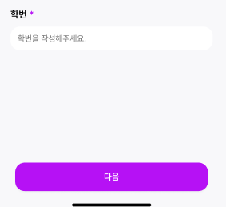

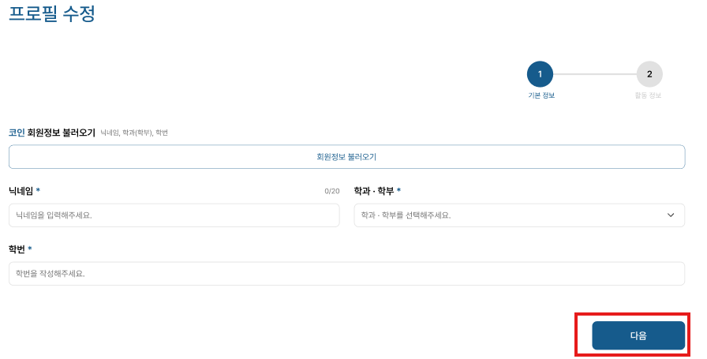

④ 기술 / 자격증 추가 버튼 클릭

- event\_label : team\_recruitment\_profile\_modify\_skill\_add
- value : 기술 / 자격증 추가
- event\_category : click

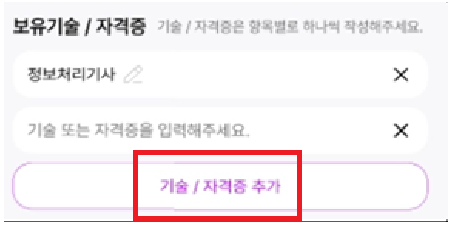

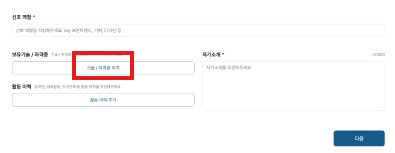

⑤ 활동 이력 수정

- event\_label : team\_recruitment\_profile\_modify\_activity\_modify
- value : 수정
- event\_category : click

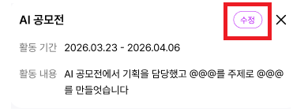

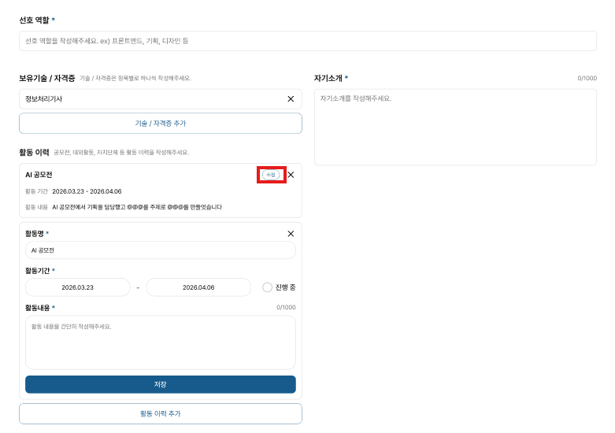

⑥ 활동 이력 수정 저장

- event\_label : team\_recruitment\_profile\_modify\_activity\_modify\_complete
- value : 수정하기
- event\_category : click

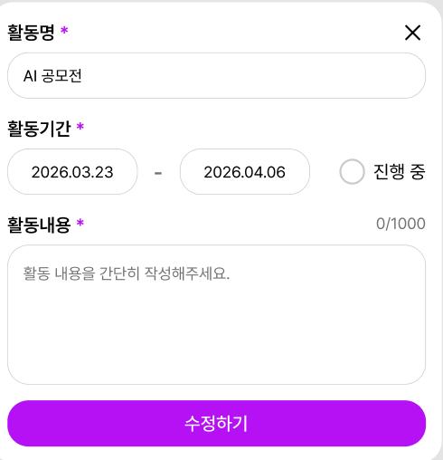

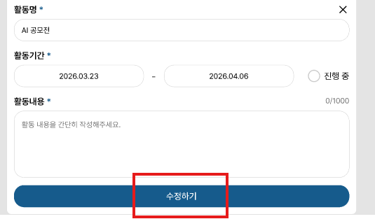

⑦ 활동 이력 추가

- event\_label : team\_recruitment\_profile\_modify\_activity\_add
- value : 활동 이력 추가
- event\_category : click

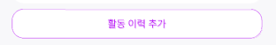

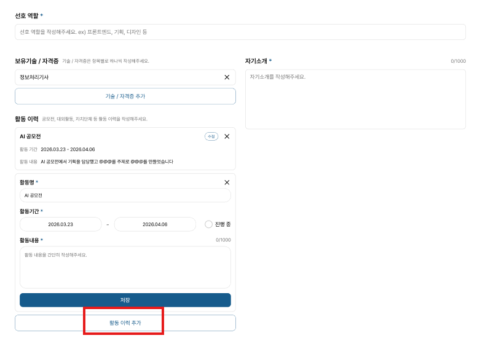

⑧ 활동 내용 추가 작성 완료

- event\_label : team\_recruitment\_profile\_modify\_activity\_complete
- value : 완료
- event\_category : click

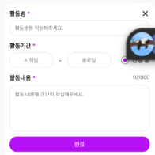

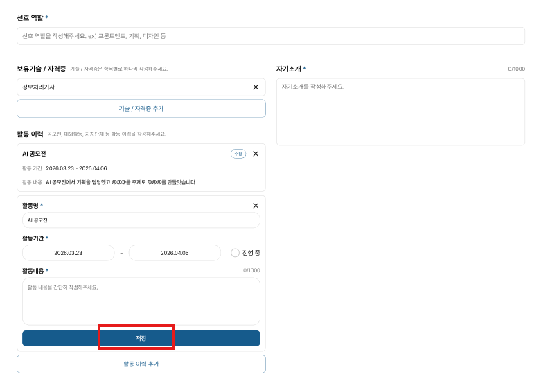

⑨ 프로필 수정하기

- event\_label : team\_recruitment\_profile\_modify\_submit
- value : 수정하기
- event\_category : click

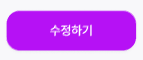

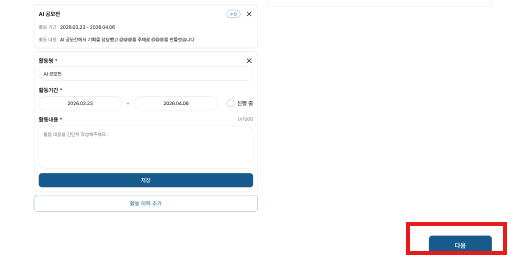

⑩ 프로필 최종 수정하기

- event\_label : team\_recruitment\_profile\_modify\_submit\_confirm
- value : 수정하기
- event\_category : result


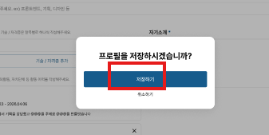

⑪ 프로필 최종 수정 취소하기

- event\_label : team\_recruitment\_profile\_modify\_submit\_cancel
- value : 취소하기
- event\_category : click

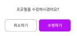

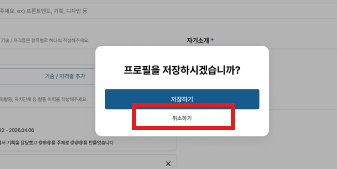
</details>

<details>
<summary>새 로깅</summary>

① 회원정보 불러오기

- 설명: 프로필 수정 화면에서 회원정보 불러오기를 클릭해 내 정보를 채우는 경우
- screen\_view: <code>team_profile_edit</code>
- event\_name: <code>DA1</code>
- event\_label: <code>team_recruit__team_profile_edit__profile_edit__load__click</code>
- value: 회원정보 불러오기
- event\_category: <code>click</code>

② 학과·학부 선택

- 설명: 프로필 수정 화면에서 학과·학부 목록 중 하나를 고르는 경우
- screen\_view: <code>team_profile_edit</code>
- event\_name: <code>DA1</code>
- event\_label: <code>team_recruit__team_profile_edit__profile_edit__major__select</code>
- value: \{학과·학부\} (예: 컴퓨터공학부)
- event\_category: <code>select</code>

③ 다음 버튼 클릭

- 설명: 프로필 수정 화면의 기본 정보 단계에서 다음 버튼을 클릭해 다음 단계로 넘어가는 경우
- screen\_view: <code>team_profile_edit</code>
- event\_name: <code>DA1</code>
- event\_label: <code>team_recruit__team_profile_edit__profile_edit__next__click</code>
- value: 다음
- event\_category: <code>click</code>

④ 기술 / 자격증 추가 버튼 클릭

- 설명: 프로필 수정 화면에서 기술 / 자격증 추가 버튼을 클릭하는 경우
- screen\_view: <code>team_profile_edit</code>
- event\_name: <code>DA1</code>
- event\_label: <code>team_recruit__team_profile_edit__profile_edit__skill_add__click</code>
- value: 기술 / 자격증 추가
- event\_category: <code>click</code>

⑤ 활동 이력 수정

- 설명: 프로필 수정 화면에서 활동 이력의 수정 버튼을 클릭하는 경우
- screen\_view: <code>team_profile_edit</code>
- event\_name: <code>DA1</code>
- event\_label: <code>team_recruit__team_profile_edit__profile_edit__activity_edit__click</code>
- value: 수정
- event\_category: <code>click</code>

⑥ 활동 이력 수정 저장

- 설명: 활동 이력 수정 창에서 수정하기를 클릭해 수정 내용을 저장하는 경우
- screen\_view: <code>team_profile_edit</code>
- event\_name: <code>DA1</code>
- event\_label: <code>team_recruit__team_profile_edit__profile_edit__activity_edit_confirm__click</code>
- value: 수정하기
- event\_category: <code>click</code>

⑦ 활동 이력 추가

- 설명: 프로필 수정 화면에서 활동 이력 추가 버튼을 클릭하는 경우
- screen\_view: <code>team_profile_edit</code>
- event\_name: <code>DA1</code>
- event\_label: <code>team_recruit__team_profile_edit__profile_edit__activity_add__click</code>
- value: 활동 이력 추가
- event\_category: <code>click</code>

⑧ 활동 내용 추가 작성 완료

- 설명: 활동 이력 추가 창에서 완료를 클릭해 새 활동 이력을 넣는 경우
- screen\_view: <code>team_profile_edit</code>
- event\_name: <code>DA1</code>
- event\_label: <code>team_recruit__team_profile_edit__profile_edit__activity_add_confirm__click</code>
- value: 완료
- event\_category: <code>click</code>

⑨ 프로필 수정하기

- 설명: 프로필 수정 화면 하단의 수정하기 버튼을 클릭해 수정 확인 팝업을 여는 경우
- screen\_view: <code>team_profile_edit</code>
- event\_name: <code>DA1</code>
- event\_label: <code>team_recruit__team_profile_edit__profile_edit__open__click</code>
- value: 수정하기
- event\_category: <code>click</code>

⑩ 프로필 최종 수정하기

- 설명: 수정 확인 팝업에서 수정하기를 클릭해 프로필 수정을 최종 저장하는 경우
- screen\_view: <code>team_profile_edit</code>
- event\_name: <code>DA1</code>
- event\_label: <code>team_recruit__team_profile_edit__profile_edit__confirm__click</code>
- value: 수정하기
- event\_category: <code>click</code>

⑪ 프로필 최종 수정 취소하기

- 설명: 수정 확인 팝업에서 취소하기를 클릭해 팝업을 닫는 경우
- screen\_view: <code>team_profile_edit</code>
- event\_name: <code>DA1</code>
- event\_label: <code>team_recruit__team_profile_edit__profile_edit__cancel__click</code>
- value: 취소하기
- event\_category: <code>click</code>

### 참고사진 (프로필 수정하기 내부)

웹 사진은 전 이벤트 없음 (추가 필요). ⑩ ⑪은 모바일 사진도 없음 (추가 필요).

① 회원정보 불러오기

<columns>
<column ratio="50">
<b>웹</b>

<b>참고사진 · 웹</b>

웹 — 사진 없음 (추가 필요)
</column>
<column ratio="50">
<b>모바일</b>

<b>참고사진 · 모바일</b>

모바일 — 회원정보 불러오기 (출처: stage 실제 캡처, 빨간 네모 = 클릭 위치)

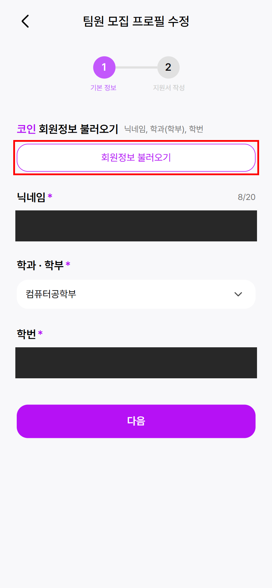
</column>
</columns>

② 학과·학부 선택

<columns>
<column ratio="50">
<b>웹</b>

<b>참고사진 · 웹</b>

웹 — 사진 없음 (추가 필요)
</column>
<column ratio="50">
<b>모바일</b>

<b>참고사진 · 모바일</b>

모바일 — 학과·학부 선택 (출처: stage 실제 캡처, 빨간 네모 = 클릭 위치)

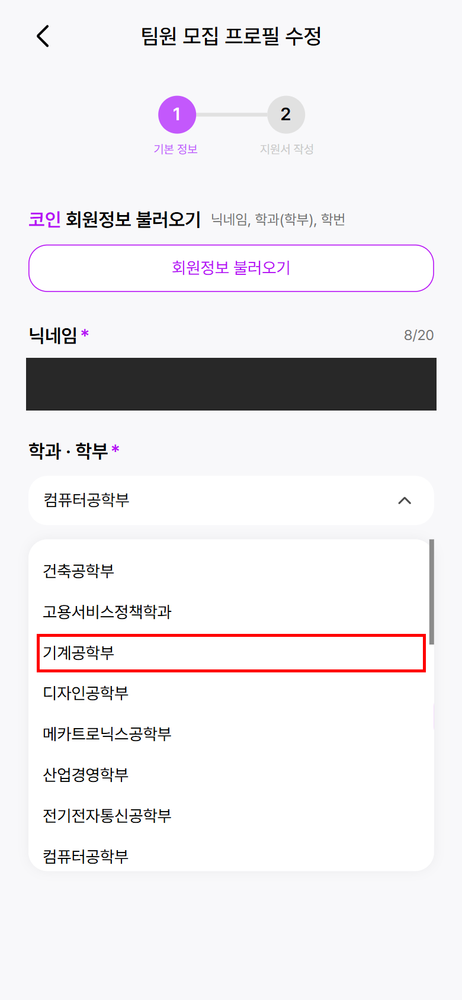
</column>
</columns>

③ 다음 버튼 클릭

<columns>
<column ratio="50">
<b>웹</b>

<b>참고사진 · 웹</b>

웹 — 사진 없음 (추가 필요)
</column>
<column ratio="50">
<b>모바일</b>

<b>참고사진 · 모바일</b>

모바일 — 다음 버튼 (출처: stage 실제 캡처, 빨간 네모 = 클릭 위치)


</column>
</columns>

④ 기술 / 자격증 추가 버튼 클릭

<columns>
<column ratio="50">
<b>웹</b>

<b>참고사진 · 웹</b>

웹 — 사진 없음 (추가 필요)
</column>
<column ratio="50">
<b>모바일</b>

<b>참고사진 · 모바일</b>

모바일 — 기술 / 자격증 추가 (출처: stage 실제 캡처, 빨간 네모 = 클릭 위치)

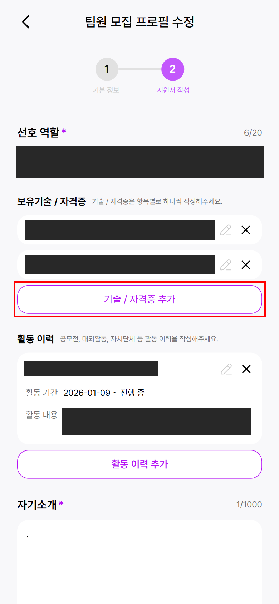
</column>
</columns>

⑤ 활동 이력 수정

<columns>
<column ratio="50">
<b>웹</b>

<b>참고사진 · 웹</b>

웹 — 사진 없음 (추가 필요)
</column>
<column ratio="50">
<b>모바일</b>

<b>참고사진 · 모바일</b>

모바일 — 활동 이력 수정 (출처: stage 실제 캡처, 빨간 네모 = 클릭 위치)

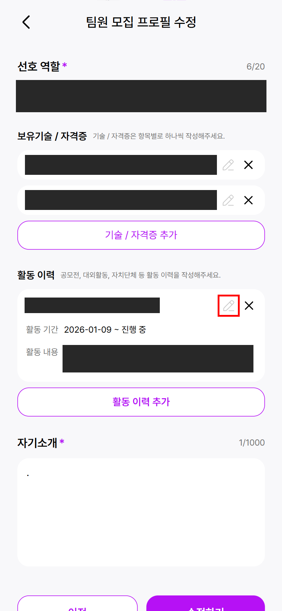
</column>
</columns>

⑥ 활동 이력 수정 저장

<columns>
<column ratio="50">
<b>웹</b>

<b>참고사진 · 웹</b>

웹 — 사진 없음 (추가 필요)
</column>
<column ratio="50">
<b>모바일</b>

<b>참고사진 · 모바일</b>

모바일 — 활동 이력 수정 저장 (출처: stage 실제 캡처, 빨간 네모 = 클릭 위치)

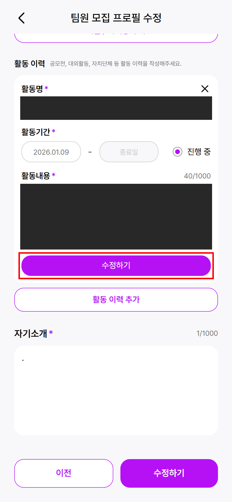
</column>
</columns>

⑦ 활동 이력 추가

<columns>
<column ratio="50">
<b>웹</b>

<b>참고사진 · 웹</b>

웹 — 사진 없음 (추가 필요)
</column>
<column ratio="50">
<b>모바일</b>

<b>참고사진 · 모바일</b>

모바일 — 활동 이력 추가 (출처: stage 실제 캡처, 빨간 네모 = 클릭 위치)

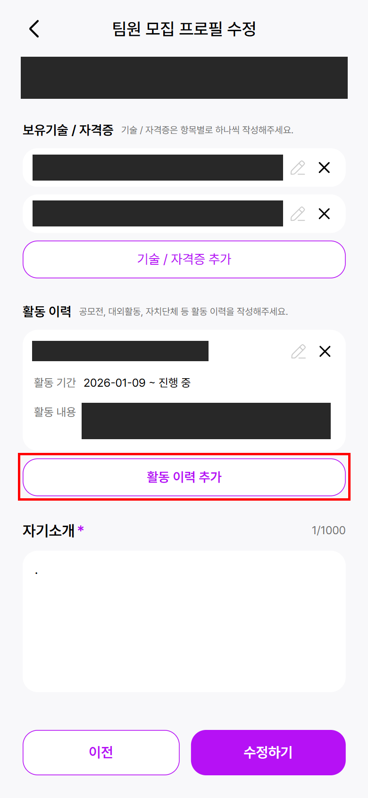
</column>
</columns>

⑧ 활동 내용 추가 작성 완료

<columns>
<column ratio="50">
<b>웹</b>

<b>참고사진 · 웹</b>

웹 — 사진 없음 (추가 필요)
</column>
<column ratio="50">
<b>모바일</b>

<b>참고사진 · 모바일</b>

모바일 — 활동 내용 추가 작성 완료 (출처: stage 실제 캡처, 빨간 네모 = 클릭 위치)

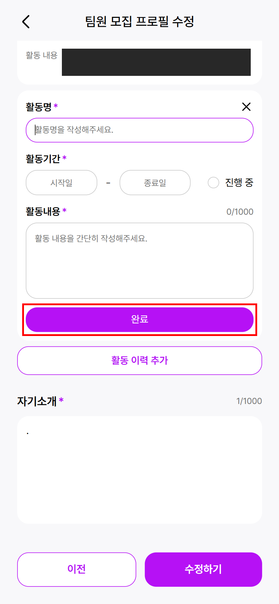
</column>
</columns>

⑨ 프로필 수정하기

<columns>
<column ratio="50">
<b>웹</b>

<b>참고사진 · 웹</b>

웹 — 사진 없음 (추가 필요)
</column>
<column ratio="50">
<b>모바일</b>

<b>참고사진 · 모바일</b>

모바일 — 프로필 수정하기 (출처: stage 실제 캡처, 빨간 네모 = 클릭 위치)

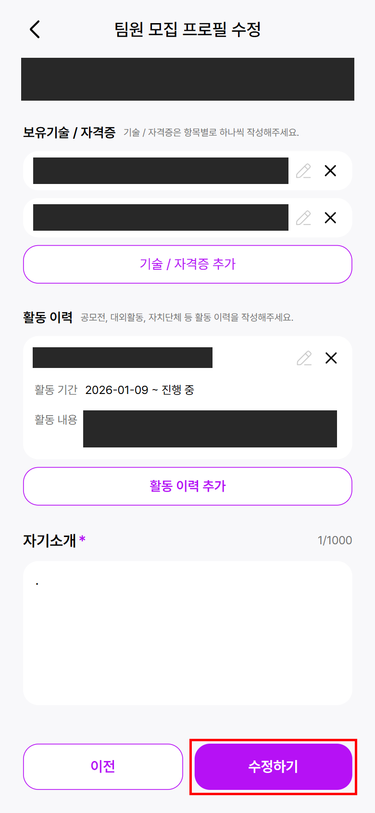
</column>
</columns>

⑩ 프로필 최종 수정하기

<columns>
<column ratio="50">
<b>웹</b>

<b>참고사진 · 웹</b>

웹 — 사진 없음 (추가 필요)
</column>
<column ratio="50">
<b>모바일</b>

<b>참고사진 · 모바일</b>

모바일 — 사진 없음 (추가 필요)
</column>
</columns>

⑪ 프로필 최종 수정 취소하기

<columns>
<column ratio="50">
<b>웹</b>

<b>참고사진 · 웹</b>

웹 — 사진 없음 (추가 필요)
</column>
<column ratio="50">
<b>모바일</b>

<b>참고사진 · 모바일</b>

모바일 — 사진 없음 (추가 필요)
</column>
</columns>
</details>
