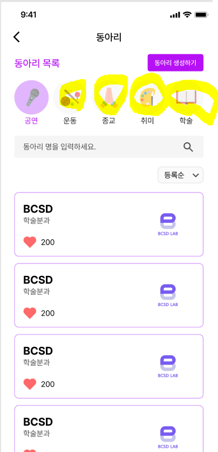
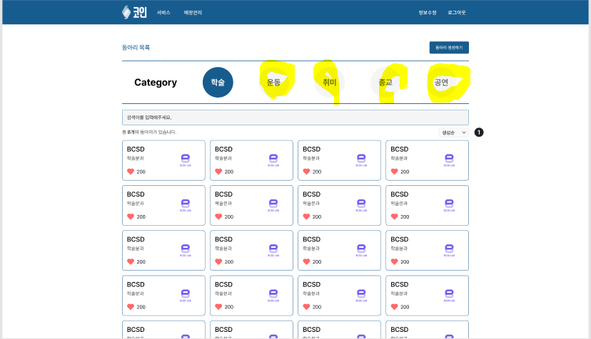

# 2-3.동아리_동아리 카테고리 클릭

원문 페이지 ID: 79d0221954bc8292ae0381170d8b1a3c

> 사용자 제공 ZIP 내보내기 보관본. 레거시·동결·검토 상태는 원문을 따르며 코드 생성 승인·앱 배포 완료를 뜻하지 않습니다.

platform: ANDROID, IOS, WEB
상태: 완료

- 설명: 동아리 메인화면에서 동아리 카테고리 클릭
- event_name : “CAMPUS”
- event_label : “club_main_category”
- value : {”공연”,”운동”,”종교”,”취미”,”학술”}
- event_category : “click”
- 참고사진

- 웹 참고사진

