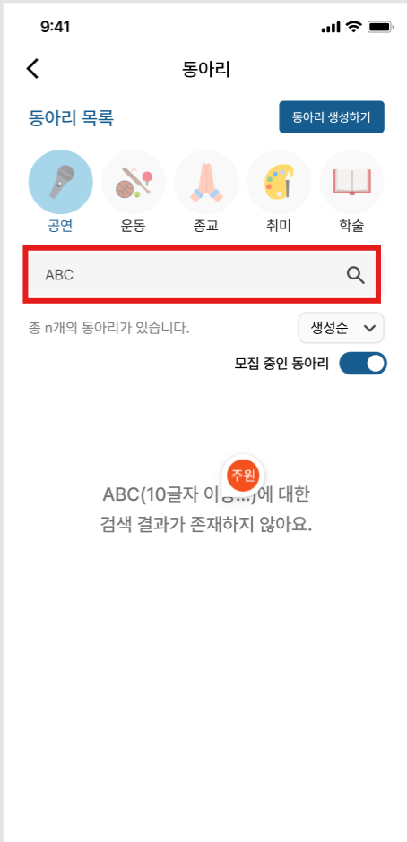
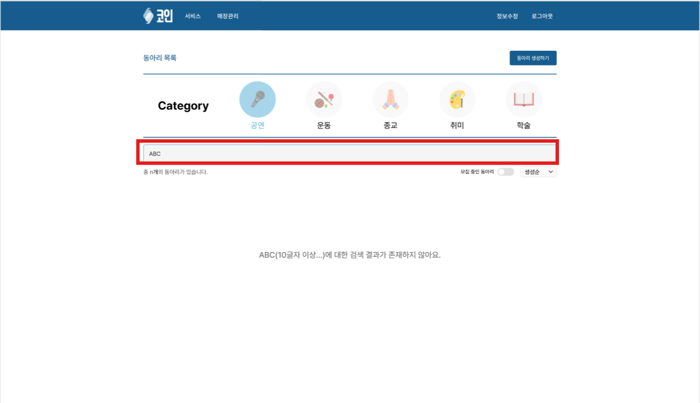

# 2.7 동아리_동아리 검색

원문 페이지 ID: 7af0221954bc829d9dd101f6fa0ed94a

> 필터 밖 원본 행 복구 스냅샷. 중복·빈 페이지도 원본 ID와 속성, 본문을 개별 보존합니다. 명세 승인이나 앱 적용 완료를 뜻하지 않습니다.

대조 기록: [숨겨진 원본 42개 복구](../hidden-recovery.md)

관련 기존 보관본: [레거시 2.7 동아리_동아리 검색](2ac0221954bc832e85f501140086f891.md), [레거시 2.7 동아리_동아리 검색](cee0221954bc8238984601ee34b16a47.md)

## 원문 속성

```json
{
  "platform": [
    "ANDROID",
    "IOS",
    "WEB"
  ],
  "url": "source-page-id:7af0221954bc829d9dd101f6fa0ed94a",
  "상태": "로깅 필요",
  "이름": "2.7 동아리\\_동아리 검색"
}
```

<ul>
<li>
설명: 동아리 메인화면에서 동아리 검색
</li>
<li>
event\_name : “CAMPUS”
</li>
<li>
event\_label : “club\_main\_search”
</li>
<li>
value : \{검색어\}
</li>
<li>
event\_category : “click” 
</li>
<li>
참고사진
</li>
</ul>





- 웹 참고사진



