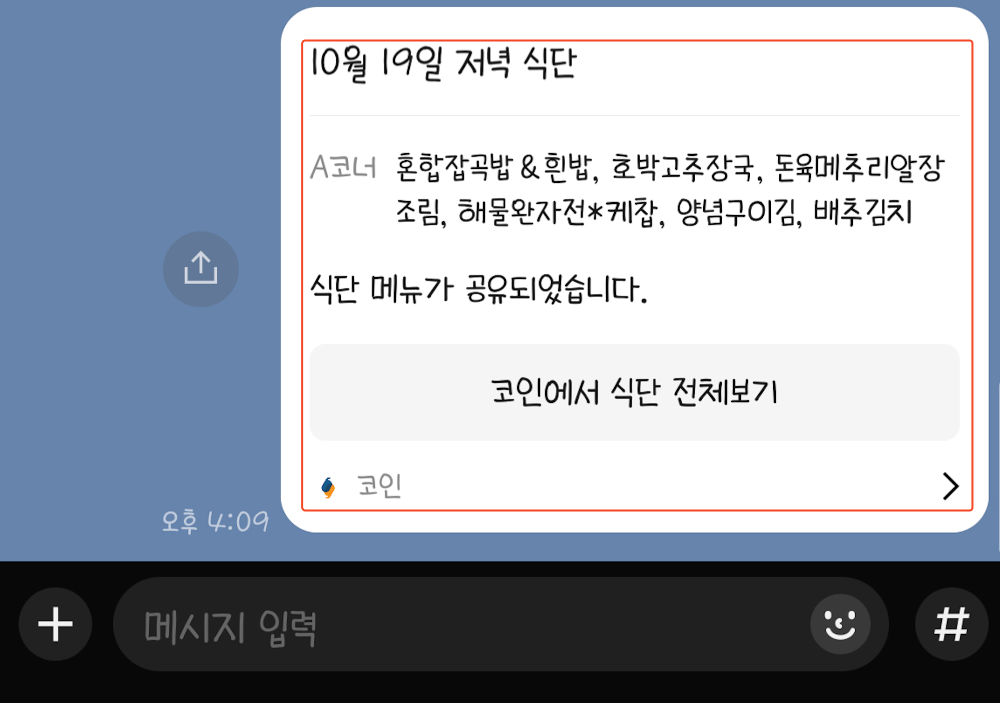
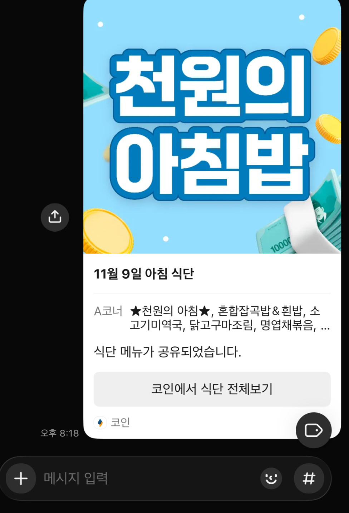

# 3-9. (Android / iOS) 식단_카카오톡_코인이동_클릭 (카카오톡)

> 원본 복구 대조: [별도 원본 ID 75a0221954bc8271ad76810365b94708](75a0221954bc8271ad76810365b94708.md)와 [차이 정리](../recovery-review.md)를 참고하세요. 기존 값은 과거 기록으로 유지합니다.

원문 페이지 ID: 7b80221954bc826aa9ea01960bfe1fa6

> 원문 스냅샷. 명세 확정·앱 배포·수집 완료를 뜻하지 않습니다.

## 원문 속성

```json
{
  "platform": [
    "ANDROID",
    "IOS"
  ],
  "url": "source-page-id:7b80221954bc826aa9ea01960bfe1fa6",
  "상태": "완료",
  "생성일": "2026-11-12T05:07:48.696Z",
  "이름": "3-9. (Android / iOS) 식단\\_카카오톡\\_코인이동\\_클릭 (카카오톡)",
  "태그": [
    "3. 식단 상세페이지"
  ]
}
```

<details>
<summary>과거 로깅</summary>

- 설명 : 카톡으로 공유받은 식단 클릭
- event\_label : “menu\_share”
- value : “코인으로 이동<b>”</b>
- event\_category : “click”
- 참고사진


</details>

<details>
<summary>새 로깅</summary>

- 설명: 카카오톡으로 공유받은 식단 메시지에서 코인으로 이동을 눌러 앱 식단 화면으로 들어오는 경우 (기존에는 공유하기와 같은 라벨이라 분리)
- screen\_view: <code>from_external</code>
- event\_name: <code>DA1</code>
- event\_label: <code>cafeteria__from_external__cafeteria_entry__kakao_entry__click</code>
- value: 코인으로 이동
- event\_category: <code>click</code>

### 참고사진 (카카오톡 코인으로 이동)

<columns>
<column ratio="50">
<b>웹</b>

<b>참고사진 · 웹</b>

해당 없음 (앱 전용)
</column>
<column ratio="50">
<b>모바일</b>

<b>참고사진 · 모바일</b>


</column>
</columns>
</details>
