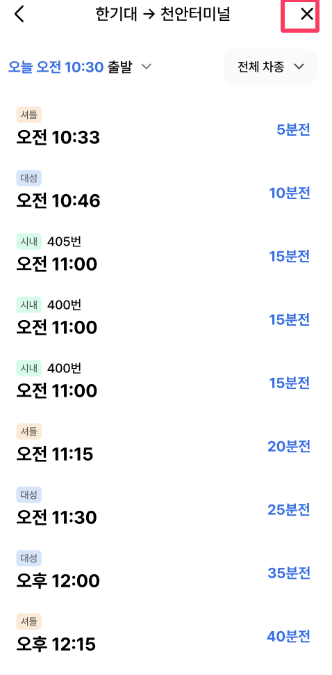

# 5-8. 닫기_클릭

원문 페이지 ID: 7c60221954bc82b592d201ab2709de4c

> 원문 스냅샷. 명세 확정·앱 배포·수집 완료를 뜻하지 않습니다.

## 원문 속성

```json
{
  "platform": [
    "ANDROID",
    "IOS"
  ],
  "url": "source-page-id:7c60221954bc82b592d201ab2709de4c",
  "구분": "조회 결과 페이지",
  "상태": "완료",
  "생성일": "2026-11-08T10:51:40.929Z",
  "이벤트 이름": "5-8. 닫기\\_클릭",
  "태그": [
    "5. 교통편 조회하기"
  ]
}
```

<details>
<summary>이전 로깅</summary>

- 교통편 조회하기 페이지로 이동
- event\_label : “search\_result\_close”
- value : “뒤로가기<b>”</b>
- event\_category : “click”
- 참고사진


</details>

<details>
<summary>새 로깅 (26.10.17)</summary>

- 설명: 교통편 조회 결과 화면에서 닫기(X)를 클릭해 버스 교통편 화면으로 돌아가는 경우
- screen\_view: <code>bus_search_result</code>
- event\_name: <code>DA1</code>
- event\_label: <code>bus__bus_search_result__navigation__bus_search_return__click</code>
- value: 닫기 (기존 뒤로가기는 5-7과 겹쳐서 수정)
- event\_category: <code>click</code>

<details>
<summary>검토사항</summary>

- 통합 가이드: [로깅 통합 가이드](3c30221954bc8214b1c481c5bbb6fba5.md)
- 앱 전용 이벤트. 기존 앱 참고사진 사본을 아래에 첨부했으며 현행 앱 화면·구현은 미검증.
- label DA2 기준 정렬 (2026-10-27): <code>bus__bus_search_result__close__click</code> → <code>bus__bus_search_result__navigation__bus_search_return__click</code>
</details>

### 참고사진 (기능 표시)

<columns>
<column ratio="50">
<b>웹</b>

<details>
<summary>참고사진 · 웹</summary>

웹 — 앱 전용 화면 (웹 없음), 앱 캡처 필요
</details>
</column>
<column ratio="50">
<b>모바일</b>

<details>
<summary>참고사진 · 모바일</summary>

출처: 이 페이지 이전 로깅의 기존 앱 참고사진 사본. 표시 대상은 현행 설명과 대조했으며, 현행 앱의 화면·구현은 미검증입니다. 빨간 네모는 동작 대상입니다.

파란색 구버전 모바일 사진 제거 (2026-10-30).
</details>
</column>
</columns>
</details>
