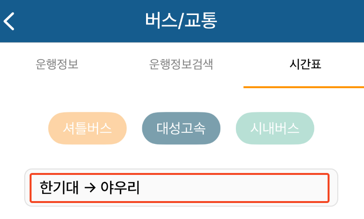
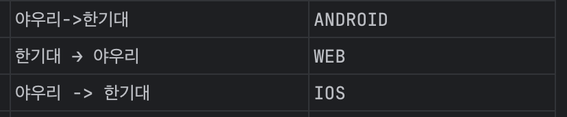

# 3-10. 버스_시간표_대성고속_목적지_클릭

원문 페이지 ID: 7cc0221954bc8386b2178192e0ef6683

> 원문 스냅샷. 명세 확정·앱 배포·수집 완료를 뜻하지 않습니다.

## 원문 속성

```json
{
  "platform": [
    "ANDROID",
    "IOS",
    "WEB"
  ],
  "url": "source-page-id:7cc0221954bc8386b2178192e0ef6683",
  "구분": "시간표 (WEB / Android / iOS)",
  "상태": "레거시",
  "생성일": "2026-11-08T10:51:38.517Z",
  "이벤트 이름": "3-10. 버스\\_시간표\\_대성고속\\_목적지\\_클릭",
  "태그": [
    "3. 버스/교통 상세 페이지"
  ]
}
```

<details>
<summary>이전 로깅</summary>

- event\_label : “bus\_timetable\_express”
- value : “OOO → OOO<b>”</b>
  - 한기대 → 야우리, 야우리 → 한기대
- event\_category : “click”
- 참고사진



---

<span color="orange">(Android, iOS 재로깅 부탁드립니다)</span>

<code>bus_timetable_express</code>

현재 로깅되어있는 value값이 각각 달라,

<u>value : ‘OOO → OOO’ 으로 Web과 통일 필요</u>


</details>

<details>
<summary>새 로깅 (26.10.17)</summary>

- 레거시: 지금 앱에 없는 화면(구 시간표의 대성고속 목적지 선택)이라 새 로깅을 만들지 않는다.
- 대체 로깅: 4-9. 대성버스 운행방면\_클릭 (<code>bus__bus_timetable__filter__daeseong_direction__select</code>)

<details>
<summary>검토사항</summary>

- 통합 가이드: [로깅 통합 가이드](3c30221954bc8214b1c481c5bbb6fba5.md)
- 레거시 항목이라 새 로깅·참고사진 없음.
- label 점검 정정 (2026-10-28): <code>bus__bus_timetable__daeseong_direction__select</code> → <code>bus__bus_timetable__filter__daeseong_direction__select</code> (대체 로깅 안내가 대상 페이지 4-9의 현재 라벨과 다름)
</details>

### 참고사진 (기능 표시)

<columns>
<column ratio="50">
<b>웹</b>

<details>
<summary>참고사진 · 웹</summary>

웹 — 해당 없음 (레거시)
</details>
</column>
<column ratio="50">
<b>모바일</b>

<details>
<summary>참고사진 · 모바일</summary>

모바일 — 해당 없음 (레거시)
</details>
</column>
</columns>
</details>
