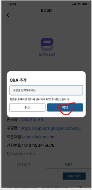
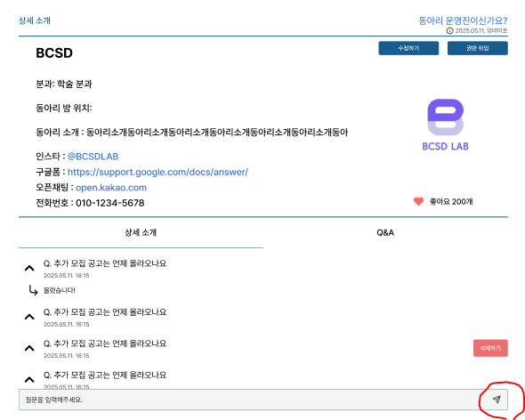

# 4-2. 동아리_Q&A추가_확인

원문 페이지 ID: 7d80221954bc8207afc4013412e37652

> 필터 밖 원본 행 복구 스냅샷. 중복·빈 페이지도 원본 ID와 속성, 본문을 개별 보존합니다. 명세 승인이나 앱 적용 완료를 뜻하지 않습니다.

대조 기록: [숨겨진 원본 42개 복구](../hidden-recovery.md)

관련 기존 보관본: [레거시 4-2. 동아리_Q&A추가_확인](d260221954bc839e9bc3814b4a06d78a.md), [레거시 4-2. 동아리_Q&A추가_확인](3510221954bc8232a9138168496258f8.md)

## 원문 속성

```json
{
  "platform": [
    "ANDROID",
    "IOS",
    "WEB"
  ],
  "url": "source-page-id:7d80221954bc8207afc4013412e37652",
  "상태": "완료",
  "이름": "4-2. 동아리\\_Q&A추가\\_확인"
}
```

<ul>
<li>
설명: 
</li>
</ul>

모바일 :Q&A 추가 팝업 에서 확인 클릭

웹 : 질문 입력창의 우측에 있는 버튼 클릭

<ul>
<li>
event\_name : “CAMPUS”
</li>
<li>
event\_label : “club\_Q&A\_add\_confirm”
</li>
<li>
value : “Q&A”
</li>
<li>
event\_category : “click” 
</li>
<li>
참고사진
</li>
</ul>





- 웹 참고사진



