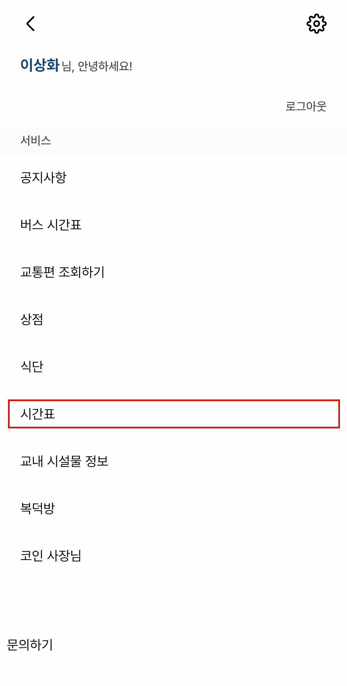
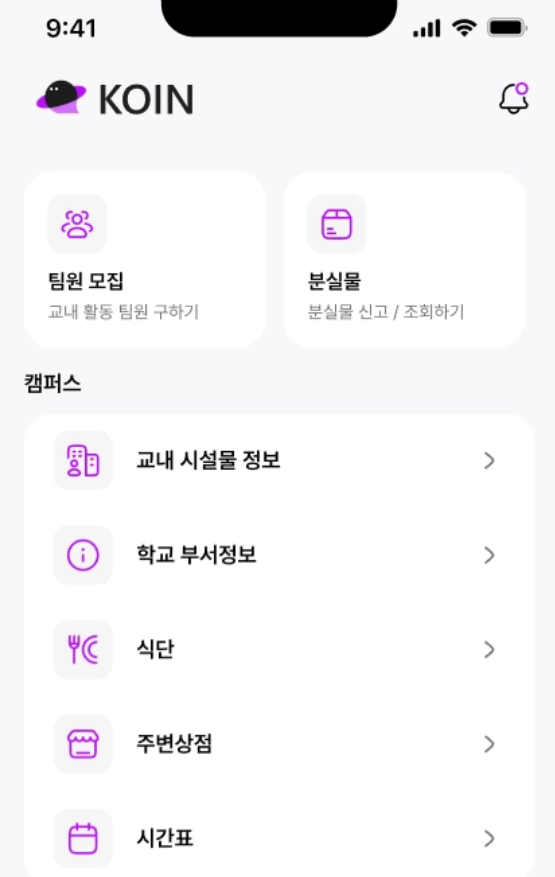

# 2-5. (앱, 반응형 웹) 카테고리_시간표

원문 페이지 ID: 7e00221954bc8322974c817d4214dbbe

> 원문 스냅샷. 명세 확정·앱 배포·수집 완료를 뜻하지 않습니다.

## 원문 속성

```json
{
  "platform": [
    "ANDROID",
    "IOS"
  ],
  "url": "source-page-id:7e00221954bc8322974c817d4214dbbe",
  "상태": "완료",
  "생성일": "2026-11-08T10:52:11.507Z",
  "이벤트 이름": "2-5. (앱, 반응형 웹) 카테고리\\_시간표",
  "태그": [
    "시간표"
  ]
}
```

<details>
<summary>이전 로깅</summary>

- event\_label : “hamburger”
- value : “시간표”
- event\_category : “click”
- 참고 이미지


</details>

<details>
<summary>새 로깅 (26.10.17)</summary>

- 설명: 모바일 상단 메뉴(☰, 햄버거)를 열고 서비스 목록에서 시간표를 클릭해 시간표 화면으로 들어가는 경우
- screen\_view: <code>main_category</code>
- event\_name: <code>DA1</code>
- event\_label: <code>timetable__main_category__timetable_entry__category_entry__click</code>
- value: 시간표
- event\_category: <code>click</code>

<details>
<summary>검토사항</summary>

- 대표 명세·상호 참조: [2-21. (앱, 반응형 웹) 카테고리_시간표 진입 (클릭) - 추가된 로깅](4b00221954bc838a8ab78176a56ac41c.md)가 기존 기준 명세다. 이 페이지는 메뉴 경로의 대응 설명이며, 문서 수만큼 추가 전송하지 않는다. 실제 호출과 플랫폼별 발화는 미확인.
- 통합 가이드·후속: [로깅 통합 가이드](3c30221954bc8214b1c481c5bbb6fba5.md)
- 웹: 없음
- label DA2 기준 정렬 (2026-10-27): <code>timetable__hamburger__timetable_entry__category_entry__click</code> → <code>timetable__main_category__timetable_entry__category_entry__click</code>
- 명세 중복 정리 (2026-10-27): <code>timetable__main_category__timetable_entry__category_entry__click</code>의 기준 명세는 [2-21. (앱, 반응형 웹) 카테고리_시간표 진입 (클릭) - 추가된 로깅](4b00221954bc838a8ab78176a56ac41c.md). 서비스 진입 목적은 같고 웹 메뉴·앱 카테고리 등 플랫폼별 경로는 각 원문을 따른다. 같은 사용자 동작은 한 번만 전송하며, 문서가 여러 개라는 이유로 추가 이벤트를 보내지 않는다. 기존 value·플랫폼·발생 시점은 유지한다.
- 화면명 정렬 (2026-10-27): 카테고리 고정 화면명 main\_category와 라벨의 페이지 구간을 일치시켰다. 플랫폼별 진입 경로와 플랫폼 속성은 원문대로 유지한다.
- label DA2 기준 정렬 (2026-10-27): <code>timetable__hamburger__entry__click</code> → <code>timetable__hamburger__timetable_entry__category_entry__click</code>
</details>

### 참고사진 (기능 표시)

<columns>
<column ratio="50">
<b>웹</b>

<details>
<summary>참고사진 · 웹</summary>

해당 없음 (모바일 전용)
</details>
</column>
<column ratio="50">
<b>모바일</b>

<details>
<summary>참고사진 · 모바일</summary>

모바일 — 햄버거 메뉴의 시간표 (출처: stage 실제 캡처, 빨간 네모 = 클릭 위치)


</details>
</column>
</columns>
</details>
