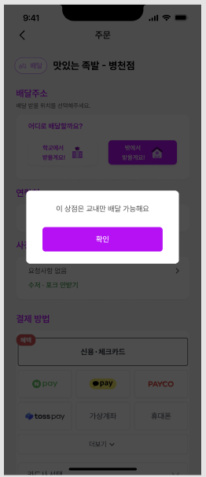

# 7-18 결제 페이지 결제 실패 (교내만 배달 가능, 6월 29일 수정)

원문 페이지 ID: 7e70221954bc83108f8a810be0e3164a

> 원문 스냅샷. 명세 확정·앱 배포·수집 완료를 뜻하지 않습니다.

## 원문 속성

```json
{
  "platform": [
    "WEB"
  ],
  "url": "source-page-id:7e70221954bc83108f8a810be0e3164a",
  "상태": "로깅 필요",
  "생성일": "2026-11-12T05:07:48.078Z",
  "이벤트 이름": "7-18 결제 페이지 결제 실패 (교내만 배달 가능, 6월 29일 수정)",
  "태그": [
    "7. 결제 페이지"
  ]
}
```




결제 페이지에서 결제에 실패하여 해당 확인 버튼 클릭 로깅입니다<br />

event\_params.key

<ul>
<li>
event\_label : payment\_delievery\_onlyCampus
</li>
<li>
value : 

- \{상점이름\}
</li>
<li>
event\_category :

- click
</li>
</ul>
