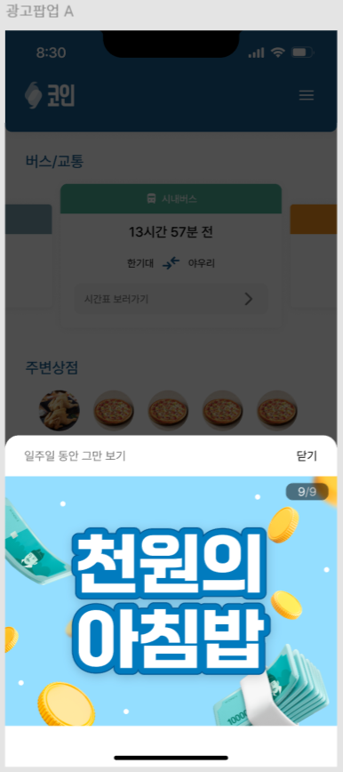
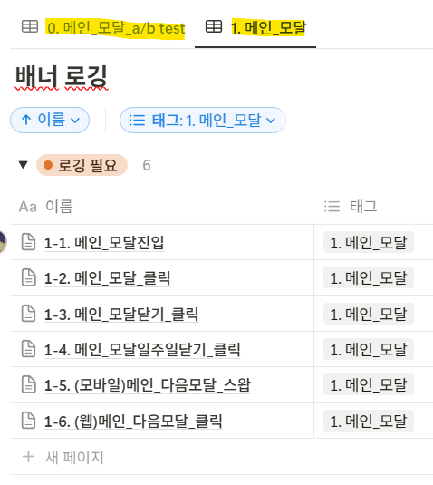

# 🏳️ 배너

원문 페이지 ID: 8080221954bc826d86cb811d51850a3c

> 원문 스냅샷. 명세 확정·앱 배포·수집 완료를 뜻하지 않습니다.

## 원문 속성

```json
{
  "title": "배너"
}
```

<callout icon="💡" color="gray_bg">
<details>
<summary>Firebase (<b>screen\_view</b>) 배너</summary>

<columns>
<column ratio="50">
### IOS

\- 메인 배너 모달:   미정
</column>
<column ratio="50">
### ANDROID

\-  메인 배너 모달:   미정
</column>
</columns>


</details>

<callout icon="⚠️" color="gray_bg">
아직 미정인 화면
</callout>
</callout>

<callout icon="⚠️" color="gray_bg">
a/b 로깅 탭과 메인 모달 탭이 따로 존재합니다!

<details>
<summary>참고사진</summary>


</details>
</callout>


배너 로깅 (collection-id:b7202219-54bc-8398-b4a3-873021571d1c)


### 참고사진 (WEB 홈 고정 배너 · 기존 모달과 별도)

<b>웹</b>

<details>
<summary>참고사진 · 웹 — 검토용</summary>

사용자 제공 WEB 리디자인 고정 배너 원본 1장. 기존 2개 첨부는 파일 해시까지 동일해 중복 1장을 정리했다. 본문·좌우 화살표·하단 점이 보인다. 기존 팝업 모달 배너 명세의 사진을 대체하지 않으며, 각 컨트롤의 클릭·자동 전환·전송 계약은 미확인이다. 새 로깅은 만들지 않았다.


</details>

<unknown url="source-page-id:8080221954bc826d86cb811d51850a3c" alt="copy_indicator" />

<unknown url="source-page-id:8080221954bc826d86cb811d51850a3c" alt="copy_indicator" />

<unknown url="source-page-id:8080221954bc826d86cb811d51850a3c" alt="copy_indicator" />

<unknown url="source-page-id:8080221954bc826d86cb811d51850a3c" alt="copy_indicator" />
