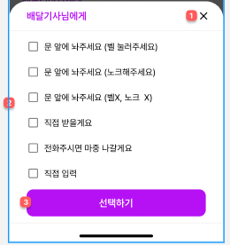

# 7-13 결제 → 교내 및 교외 주문 페이지 기사님 요청사항

원문 페이지 ID: 8140221954bc823fbe6701811920bb71

> 원문 스냅샷. 명세 확정·앱 배포·수집 완료를 뜻하지 않습니다.

## 원문 속성

```json
{
  "platform": [
    "WEB"
  ],
  "url": "source-page-id:8140221954bc823fbe6701811920bb71",
  "상태": "로깅 필요",
  "생성일": "2026-11-08T10:51:56.302Z",
  "이벤트 이름": "7-13 결제 → 교내 및 교외 주문 페이지 기사님 요청사항"
}
```




- 교내 및  교외 주문 페이지에서 동일하게 심어주시면 됩니다!
  <ul>
  <li>
  2번 체크박스 선택 후 
  </li>
  <li>
  3번 선택하기까지 클릭 시 발생하는 로깅입니다
  </li>
  </ul>


event\_params.key

- event\_label : payment\_delivery\_note
- value :
  <ul>
  <li>
  문 앞에 놔주세요(벨 눌러주세요)
  </li>
  <li>
  문 앞에 놔주세요(노크 해주세요)
  </li>
  <li>
  문 앞에 놔주세요(벨X, 노크X)
  </li>
  <li>
  직접 받을게요
  </li>
  <li>
  전화주시면 마중 나갈게요
  </li>
  <li>
  직접 입력 
  </li>
  </ul>
- event\_category :
  - click


