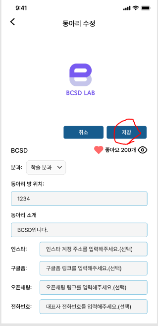
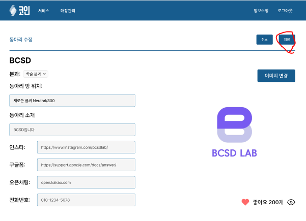

# 5-2.동아리_정보수정 저장

원문 페이지 ID: 81f0221954bc837baef201185e9fb4fd

> 필터 밖 원본 행 복구 스냅샷. 중복·빈 페이지도 원본 ID와 속성, 본문을 개별 보존합니다. 명세 승인이나 앱 적용 완료를 뜻하지 않습니다.

대조 기록: [숨겨진 원본 42개 복구](../hidden-recovery.md)

관련 기존 보관본: [레거시 5-2.동아리_정보수정 저장](0490221954bc832799b7019e39a31f57.md), [레거시 5-2.동아리_정보수정 저장](ba40221954bc82f1b99601b64285139c.md)

## 원문 속성

```json
{
  "platform": [
    "ANDROID",
    "IOS",
    "WEB"
  ],
  "url": "source-page-id:81f0221954bc837baef201185e9fb4fd",
  "상태": "완료",
  "이름": "5-2.동아리\\_정보수정 저장"
}
```

<ul>
<li>
설명: 동아리 수정 화면에서 저장 버튼 클릭
</li>
<li>
event\_name : “CAMPUS”
</li>
<li>
event\_label : “club\_correction\_save”
</li>
<li>
value : “저장”
</li>
<li>
event\_category : “click” 
</li>
<li>
참고사진
</li>
</ul>





- 웹 참고사진



