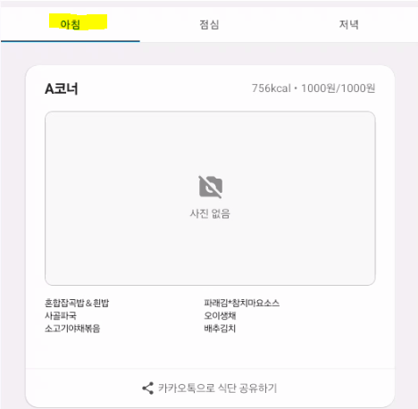
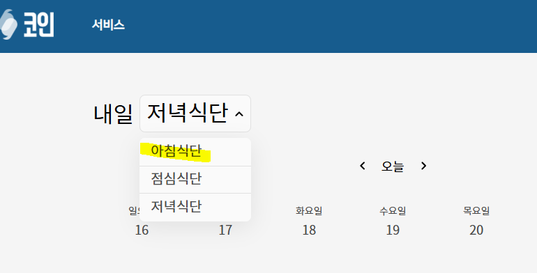
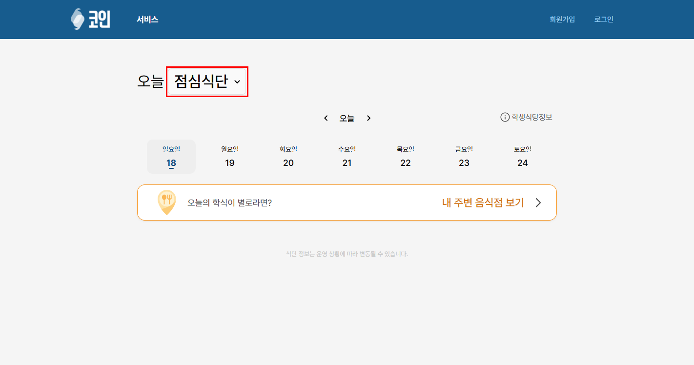
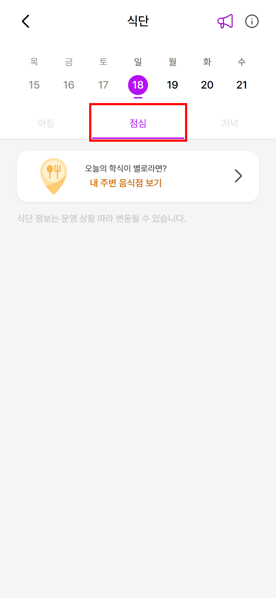

# 3-1. 식단_식사시간 선택 (클릭) - 3-2·3-3 통합

원문 페이지 ID: 8320221954bc82e0b41d8128f2e0b302

> 누락 원본 복구 스냅샷. 원본의 과거값·검토 기록을 보존하며 생성 계약으로 자동 승인하지 않습니다.

대조 기록: [87개 원본 복구 및 8개 차이 정리](../recovery-review.md)

관련 기존 보관본: [3-1. 식단_식사시간 선택 (클릭) - 3-2·3-3 통합](1830221954bc82da965501008d23f1f3.md)

## 원문 속성

```json
{
  "platform": [
    "ANDROID",
    "IOS",
    "WEB"
  ],
  "url": "source-page-id:8320221954bc82e0b41d8128f2e0b302",
  "상태": "완료",
  "생성일": "2026-11-08T10:51:35.696Z",
  "이름": "3-1. 식단\\_식사시간 선택 (클릭) - 3-2·3-3 통합",
  "태그": [
    "3. 식단 상세페이지"
  ]
}
```

<details>
<summary>이전 로깅</summary>


- 설명 : 식단페이지에서 아침 버튼 클릭
- event\_label : “menu\_time”
- value : “아침<b>”</b>
- event\_category : “click”
- 참고사진





- 웹





</details>


<details>
<summary>새 로깅 (26.10.17)</summary>


- 설명: 식단 화면에서 아침 / 점심 / 저녁 탭(web은 식사 시간 드롭다운) 중 하나를 선택해 해당 식사 시간의 식단을 보는 경우 (기존 3-1·3-2·3-3을 하나로 통합)
- screen\_view: <code>cafeteria</code>
- event\_name: <code>DA1</code>
- event\_label: <code>cafeteria__cafeteria__meal_time__select</code>
- value: 아침 / 점심 / 저녁 (예: 점심)
- event\_category: <code>select</code>

<details>
<summary>검토사항</summary>


- 통합 가이드·후속: [로깅 통합 가이드](3c30221954bc8214b1c481c5bbb6fba5.md)
- 제목 확인 완료 (2026-10-30): 현재 제목은 이미 “3-1. 식단\_식사시간 선택 (클릭) - 3-2·3-3 통합”으로 정리되어 있다. 아침만의 클릭이 아니라 아침·점심·저녁 선택을 합친 현행 설명과 일치하므로 추가 제목 변경은 하지 않는다. 라벨·value·category·플랫폼·사진은 유지한다.

</details>


### 참고사진 (식사시간 선택)


<b>웹</b>

<details>
<summary>참고사진 · 웹</summary>


웹 — 식사 시간 드롭다운 선택 (출처: stage 실제 캡처, 빨간 네모 = 클릭 위치)





</details>


<b>모바일</b>

<details>
<summary>참고사진 · 모바일</summary>


모바일 — 아침 / 점심 / 저녁 탭 선택 (출처: stage 실제 캡처, 빨간 네모 = 클릭 위치)





</details>


</details>
