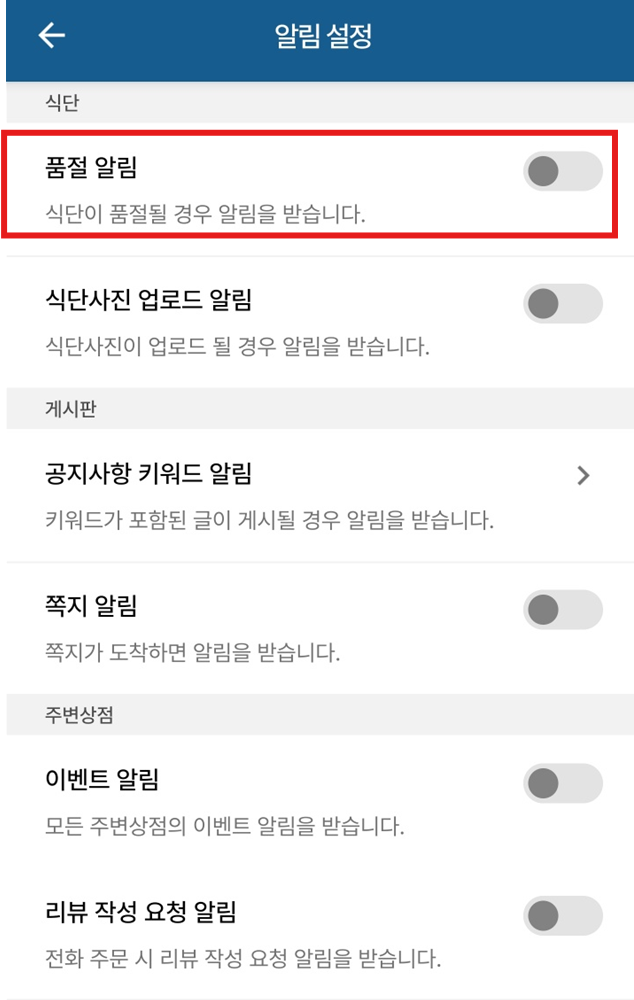

# 5-2. (Android / iOS) 알림설정_품절_토글

원문 페이지 ID: 8330221954bc8287b8be01c95c019076

> 누락 원본 복구 스냅샷. 원본의 과거값·검토 기록을 보존하며 생성 계약으로 자동 승인하지 않습니다.

대조 기록: [87개 원본 복구 및 8개 차이 정리](../recovery-review.md)

관련 기존 보관본: [5-2. (Android / iOS) 알림설정_품절_토글](2ed0221954bc830ca8f3812a30d0063f.md)

## 원문 속성

```json
{
  "platform": [
    "ANDROID",
    "IOS"
  ],
  "url": "source-page-id:8330221954bc8287b8be01c95c019076",
  "상태": "완료",
  "생성일": "2026-11-08T10:51:37.691Z",
  "이름": "5-2. (Android / iOS) 알림설정\\_품절\\_토글",
  "태그": [
    "5. 알림설정 페이지 (Android / iOS)"
  ]
}
```

<details>
<summary>이전 로깅</summary>


- 설명 : 알림 설정에서 품절 알림 클릭
- event\_label : “notification\_sold\_out”
- value : “on/off<b>”</b>
- event\_category : “click”
- 참고사진





</details>


<details>
<summary>새 로깅 (26.10.17)</summary>


- 설명: 프로필 → 설정 → 알림 화면에서 품절 알림 토글을 켜거나 끄는 경우
- screen\_view: <code>notification_config</code>
- event\_name: <code>DA1</code>
- event\_label: <code>cafeteria__notification_config__sold_out__toggle</code>
- value: 켜짐 / 꺼짐 (예: 켜짐)
- event\_category: <code>toggle</code>

<details>
<summary>검토사항</summary>


- 통합 가이드·후속: [로깅 통합 가이드](3c30221954bc8214b1c481c5bbb6fba5.md)
- 웹: 없음 (앱 전용)

</details>


### 참고사진 (품절 알림 토글)


<b>웹</b>

<details>
<summary>참고사진 · 웹</summary>


해당 없음 (앱 전용)

</details>


<b>모바일</b>

<details>
<summary>참고사진 · 모바일</summary>


앱 전용 화면 (웹 없음), 앱 캡처 필요

</details>


</details>
