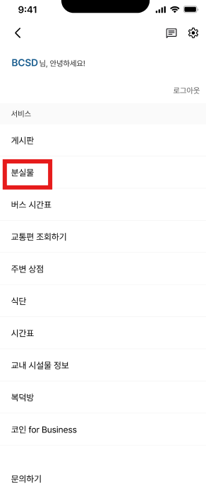
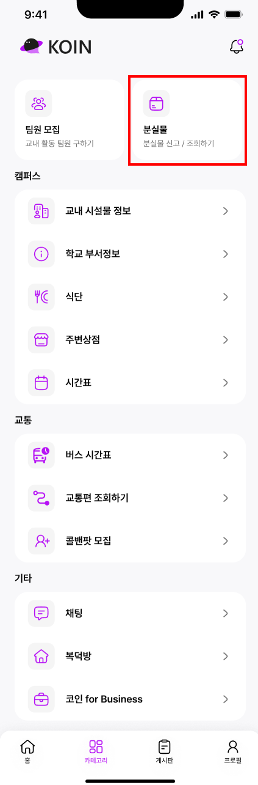

# [레거시·중복 원문] 11-21. 카테고리_분실물_클릭

원문 페이지 ID: 8390221954bc82a5a5c7014619d27bad

> 원문 스냅샷. 명세 확정·앱 배포·수집 완료를 뜻하지 않습니다.

## 원문 속성

```json
{
  "platform": [
    "ANDROID",
    "IOS"
  ],
  "url": "source-page-id:8390221954bc82a5a5c7014619d27bad",
  "상태": "완료",
  "이름": "\\[레거시·중복 원문\\] 11-21. 카테고리\\_분실물\\_클릭",
  "태그": [
    "11.분실물"
  ]
}
```

<details>
<summary>과거 로깅</summary>

- 설명: 햄버거 버튼을 누른 화면에서 분실물 버튼 클릭
- event\_label : hamburger
- value : 분실물
- event\_category : click
- 참고사진



- 설명: 메인 카테고리 화면에서 분실물 버튼을 클릭한다.
- screen\_view: <code>main_category</code>
- event\_name: <code>DA2</code>
- event\_label: <code>board__main_category__category_navigation__lost_item_entry__click</code>
- value: 분실물
- event\_category: <code>click</code>

### 참고사진 (기능 표시)

<columns>
<column ratio="50">
<b>웹</b>

이 항목은 모바일 메뉴 진입 로깅입니다.
</column>
<column ratio="50">
<b>모바일</b>

<b>참고사진 · 모바일</b>

모바일 — 카테고리의 분실물 진입


</column>
</columns>
</details>

<details>
<summary>새 로깅</summary>

레거시. [3-6 카테고리 내부 클릭 (현재 로깅) 2026.08.30 이후 찍히는 로깅](5540221954bc83d0aed681206affda1b.md)를 따른다.
</details>
