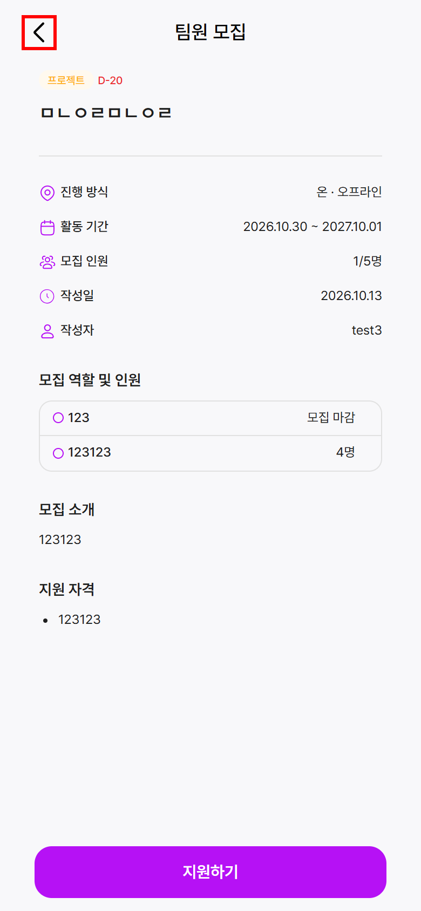

# 4-3. 모집글 상세_뒤로가기 (클릭) - 추가된 로깅

원문 페이지 ID: 83a0221954bc82838136811334007453

> 사용자 제공 ZIP 내보내기 보관본. 레거시·동결·검토 상태는 원문을 따르며 코드 생성 승인·앱 배포 완료를 뜻하지 않습니다.

생성일: 2026년 11월 8일 오후 7:52
구분: 모집글 상세 지원자
상태: 로깅 필요
platform: ANDROID, IOS

- 이전 로깅
    - 없음 (새로 추가한 로깅)
- 새 로깅 (26.10.17)
    - 설명: 모집글 상세 화면 왼쪽 위 뒤로가기(<) 버튼을 클릭해 이전 화면(팀원 모집 목록 등)으로 돌아가는 경우
    - screen_view: `team_detail`
    - event_name: `DA1`
    - event_label: `team_recruit__team_detail__navigation__back__click`
    - value: 뒤로가기
    - event_category: `click`
    - 검토사항
        - 통합 가이드·후속: [로깅 통합 가이드](3c30221954bc8214b1c481c5bbb6fba5.md)
        - 웹: 없음 (웹 상세 화면에는 뒤로가기 버튼이 없음)
        - label DA2 기준 정렬 (2026-10-27): `team_recruit__team_detail__back__click` → `team_recruit__team_detail__navigation__back__click`
    
    ### 참고사진 (뒤로가기)
    
    **웹**
    
    - 참고사진 · 웹
        
        웹 — 해당 없음 (웹 상세 화면에 뒤로가기 버튼 없음)
        
    
    **모바일**
    
    - 참고사진 · 모바일
        
        모바일 — 모집글 상세 뒤로가기 (출처: stage 실제 캡처, 빨간 네모 = 클릭 위치)
        
        
