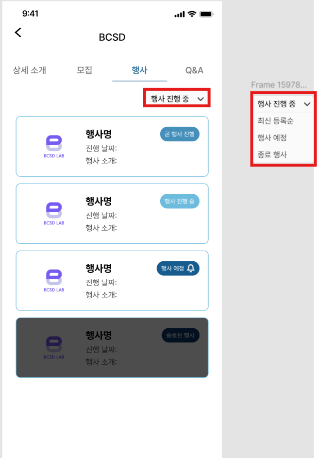
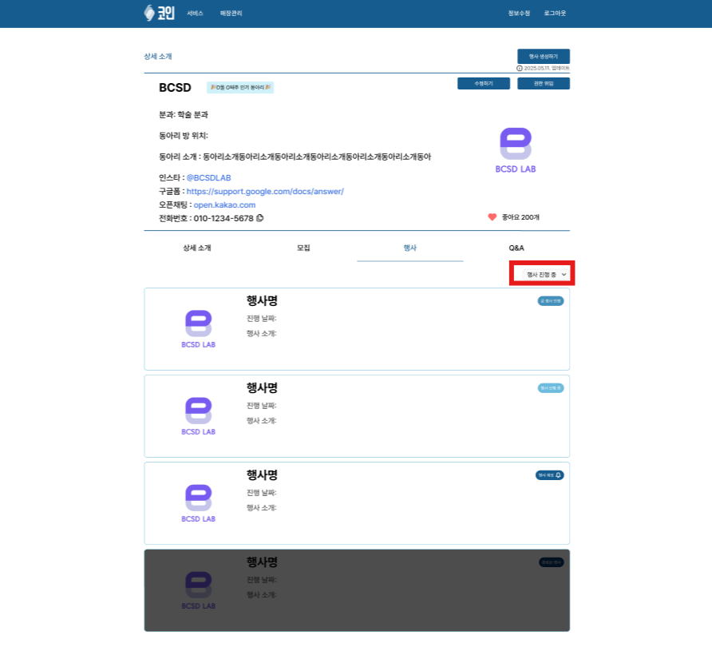

# 6.2동아리_행사필터 클릭

원문 페이지 ID: 84b0221954bc83a99e8501e94ca35d10

> 사용자 제공 ZIP 내보내기 보관본. 레거시·동결·검토 상태는 원문을 따르며 코드 생성 승인·앱 배포 완료를 뜻하지 않습니다.

platform: ANDROID, IOS, WEB
상태: 로깅 필요

- 설명: 동아리 행사 화면에서 드롭다운 형식의 필터 중 하나를 클릭
- event_name : “CAMPUS”
- event_label : “club_event_filter”
- value : (”행사 진행 중”, “최신 등록순”, “행사 예정”, “종료 행사”)
- event_category : “click”
- 참고사진

- 웹 참고사진

