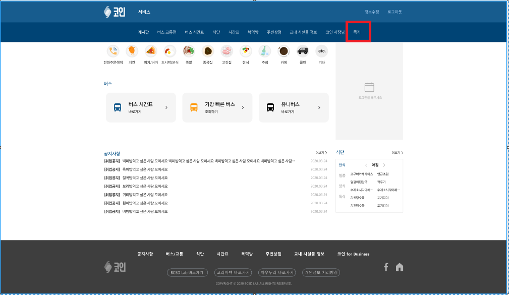

# 11-17.헤더_쪽지_클릭

원문 페이지 ID: 84c0221954bc820392b5018ecce7d80a

> 원문 스냅샷. 명세 확정·앱 배포·수집 완료를 뜻하지 않습니다.

## 원문 속성

```json
{
  "platform": [
    "WEB"
  ],
  "url": "source-page-id:84c0221954bc820392b5018ecce7d80a",
  "상태": "완료",
  "이름": "11-17.헤더\\_쪽지\\_클릭",
  "태그": [
    "11.분실물"
  ]
}
```

<details>
<summary>이전 로깅</summary>

- 설명:  웹 페이지 헤더 에서 쪽지 버튼 클릭
- event\_label : “header”
- value : “쪽지”
- event\_category : “click”
- 참고사진


WEB




</details>

<details>
<summary>새 로깅 (2026-10-15) — 수정 초안</summary>

- 구체적 발생 조건: 웹의 공용 영역에서 상단 서비스 메뉴를 열고 ‘쪽지’를 클릭한다.
- screen\_view: <code>header</code>
- event\_label: <code>chat__header__chat_entry__header_entry__click</code>
- event\_name: <code>DA2</code>
- event\_category: <code>click</code>
- value: 쪽지

<details>
<summary>검토사항</summary>

- screen\_view 확정 (2026-10-30 상민 직접 지시): event\_label의 두 번째 구간과 같은 <code>header</code> 고정값을 사용한다. 이전 동적 화면명 표기안은 이 결정으로 대체한다. 라벨·category·value·발생 시점·플랫폼·사진은 유지하며 SDK 적용·실제 전송·한 번 전송은 미확인이다.
- 통합 가이드·후속: [로깅 통합 가이드](3c30221954bc8214b1c481c5bbb6fba5.md)
- label 통일 (2026-10-27): chat\_\_header\_\_chat\_entry\_\_header\_entry → chat\_\_header\_\_chat\_entry\_\_header\_entry\_\_click
- 근거: 2026-10-15 데스크톱 웹 메인의 헤더 서비스 메뉴·푸터 항목 확인. 실제 이벤트 수집 검수는 별도.
</details>

### 참고사진 (커뮤니티 → 쪽지 · WEB 리디자인)

<b>웹</b>

<details>
<summary>참고사진 · 웹</summary>

커뮤니티 → 쪽지. 출처: [Figma WEB 리디자인](https://www.figma.com/design/DPlcYuiFxhyT5ULbqec59i/KOIN-Web?node-id=11541-33352), 2026-11-04 원본 캡처에 코드로 빨간 네모만 추가. 빨간 네모는 기존 명세가 지칭하는 클릭 대상이다. 실제 클릭 가능 여부·SDK 적용·배포·수집은 미확인이다.


</details>

<b>기존 참고사진 (과거 디자인·원문 보존)</b>

### 참고사진 (기능 표시)

<b>웹(데스크톱)</b>

<details>
<summary>참고사진 · 웹</summary>

기존 웹 명세 캡처 사본. 현재 구현·진입 경로 미확인. 내비게이션 위치 참고.


</details>
</details>
