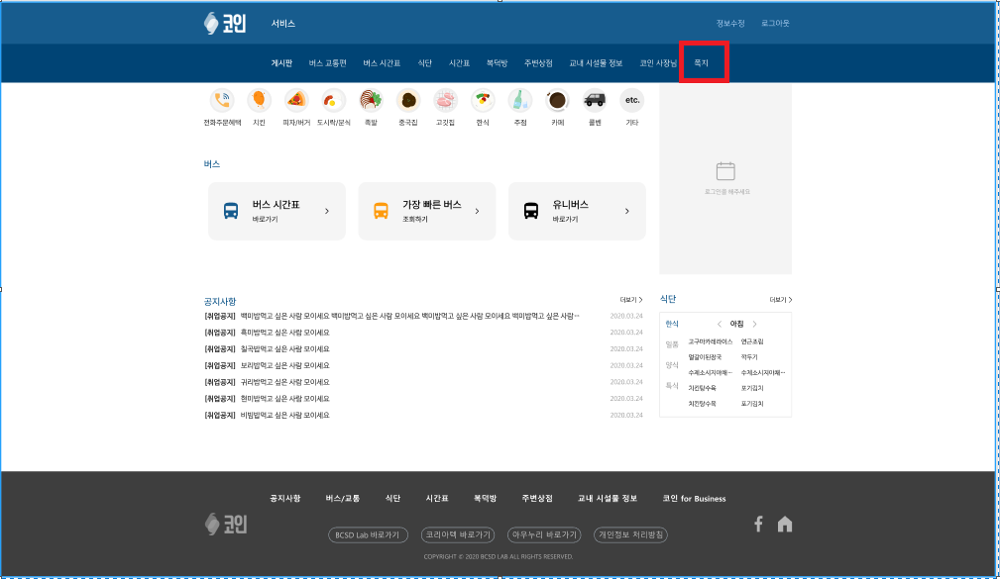

# 11-17.헤더_쪽지_클릭

원문 페이지 ID: 84c0221954bc825ea826812c72c0eb8d

> 누락 원본 복구 스냅샷. 원본의 과거값·검토 기록을 보존하며 생성 계약으로 자동 승인하지 않습니다.

대조 기록: [87개 원본 복구 및 8개 차이 정리](../recovery-review.md)

관련 기존 보관본: [11-17.헤더_쪽지_클릭](6610221954bc83c794e60155ecc5d6fc.md), [11-17.헤더_쪽지_클릭](84c0221954bc820392b5018ecce7d80a.md)

## 원문 속성

```json
{
  "platform": [
    "WEB"
  ],
  "url": "source-page-id:84c0221954bc825ea826812c72c0eb8d",
  "상태": "완료",
  "이름": "11-17.헤더\\_쪽지\\_클릭"
}
```

- 설명:  웹 페이지 헤더 에서 쪽지 버튼 클릭
- event\_label : “header”
- value : “쪽지”
- event\_category : “click”
- 참고사진


WEB





<details>
<summary>검토사항</summary>


- 후속 수정 (2026-10-27): ※ 옛 사본: 현행 명세는 게시판 DB의 같은 번호 페이지 [11-17.헤더_쪽지_클릭](6610221954bc83c794e60155ecc5d6fc.md). 이 사본은 새 로깅이 없어 변환하지 않음.

</details>
