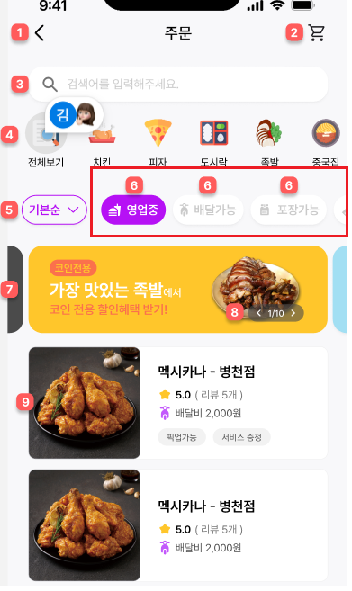
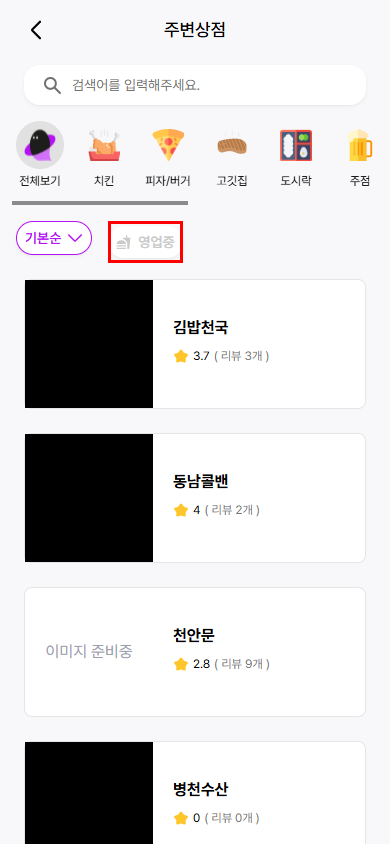

# 2-13 ~ 17 상점 카테고리 필터

원문 페이지 ID: 8730221954bc82a38e6b8105fa07523a

> 원문 스냅샷. 명세 확정·앱 배포·수집 완료를 뜻하지 않습니다.

## 원문 속성

```json
{
  "platform": [
    "ANDROID",
    "IOS"
  ],
  "url": "source-page-id:8730221954bc82a38e6b8105fa07523a",
  "상태": "로깅 필요",
  "생성일": "2026-11-08T10:51:49.124Z",
  "이벤트 이름": "2-13 \\~ 17 상점 카테고리 필터",
  "태그": [
    "2. 상점 카테고리"
  ]
}
```

<details>
<summary>이전 로깅</summary>

기존 기능 및 디자인 → 로깅 수정 및 추가(오른쪽 사진)

<columns>
<column ratio="50">

</column>
<column ratio="50">



</column>
</columns>

<columns>
<column ratio="50">
<span color="orange">event\_params.key</span>

<ul>
<li>
event\_label : shop\_can
</li>
<li>
value : 

- check\_delivery\_\{카테고리\}
- check\_open\_\{카테고리\}
</li>
<li>
event\_category : click 
</li>
</ul>
</column>
<column ratio="50">
- 영업중
- 배달가능
- 포장가능
- 배달팁무료
- 최소주문금액


<span color="orange">event\_params.key</span>

<ul>
<li>
event\_label : shop\_can
</li>
<li>
value : 

- check\_open\_\{카테고리\}
- check\_delivery\_\{카테고리\}
- check\_takeout\_\{카테고리\}
- check\_free\_delivery\_\{카테고리\}
- check\_min\_amount\_\{카테고리\}
</li>
<li>
event\_category : click 
</li>
</ul>
</column>
</columns>

---


메인화면이 아니면 주변상점 view인 경우, 영업중만 심어주시면 됩니다 !


<span color="orange">event\_params.key</span>

<ul>
<li>
event\_label : shop\_can
</li>
<li>
value : 

- check\_open\_\{카테고리\}
</li>
<li>
event\_category : click 
</li>
</ul>
</details>

<details>
<summary>새 로깅 (26.10.17)</summary>

- 설명: 상점 목록의 영업중·배달가능·포장가능·배달팁무료 토글은 해제 상태에서 선택 상태로 바뀔 때 1회 기록하고, 끌 때는 기록하지 않는다. 최소주문금액은 토글과 구분하며 기존 설정 버튼을 눌러 설정창을 여는 시점을 유지한다.
- screen\_view: <code>shop_list</code>
- event\_name: <code>DA1</code>
- event\_label: <code>shop__shop_list__filter__quick_filter__select</code>
- value: \{켠 필터\} → 영업중 / 배달가능 / 포장가능 / 배달팁무료 / 최소주문금액 (예: 영업중)
- event\_category: <code>select</code>

<details>
<summary>검토사항</summary>

- 필터 호출 구분 (2026-11-05): 퀵필터 UI에는 이 quick\_filter 라벨만 적용하고 체크박스 라벨을 함께 보내지 않는다. PC 체크박스는 [2-5~8 상점 카테고리 토글 ](75e0221954bc8290a3ac01e029e0a59c.md)를 따른다. 플랫폼 속성과 기존 value는 보존한다.
- SDK 발생 조건 불일치 (2026-11-05): 확인한 Android StoreHome 필터 칩은 클릭 전 isSelected=true에서 옛 shop\_can을 보내므로 해제 시점이다. iOS 영업중·모바일웹 영업중은 켜기와 끄기 모두 전송한다. 새 토글 계약은 해제→선택만 기록하도록 개발 반영해야 한다. 근거: [Android 칩](https://github.com/BCSDLab/KOIN_ANDROID/blob/ee67a50f554030a76cfb7d8948b89d8efc806e9d/feature/store/src/main/java/in/koreatech/koin/feature/store/home/StoreHomeScreen.kt#L575), [iOS 영업중](https://github.com/BCSDLab/KOIN_iOS/blob/f9286701b52668451840aa4b3432a3bcc8bd7aa8/Koin/Presentation/Shop/Shop/ShopViewController.swift#L197), [모바일웹 영업중](https://github.com/BCSDLab/KOIN_WEB_RECODE/blob/13f1a5d3c315a913b32b51a87e6700ea5b12d8d4/src/components/Store/mobile/StoreListPage/index.tsx#L83).
- 최소주문금액 구분 (2026-11-05): 기존 value 목록의 최소주문금액은 Android 설정창 열기 동작을 뜻한다. 실제 금액 적용(min\_amount\_set)과 같은 이벤트로 합치거나 적용 완료로 해석하지 않는다. 기존 value 필드와 라벨·category는 유지한다. 근거: [설정창 열기와 금액 선택](https://github.com/BCSDLab/KOIN_ANDROID/blob/ee67a50f554030a76cfb7d8948b89d8efc806e9d/feature/store/src/main/java/in/koreatech/koin/feature/store/home/StoreHomeScreen.kt#L594).
- 이전 검토 기록 (아래 현재 기준으로 대체) (2026-11-04): PC WEB 체크박스는 대응 명세를 따르며 이 퀵필터 계약과의 플랫폼별 호출 매핑은 개발 확인 대기다. 동일 영업중 켜기 동작을 두 번 수집하는 지시가 아니다. 모바일웹에서 확인한 영업중 외 필터와 네이티브 지원은 미확인이다. 기존 label·value·category·DB platform은 유지한다. 대응 명세: [2-5~8 상점 카테고리 토글 ](75e0221954bc8290a3ac01e029e0a59c.md).
- 통합 가이드: [로깅 통합 가이드](3c30221954bc8214b1c481c5bbb6fba5.md)
- 웹: PC 웹은 2-5\~8 체크박스와 같은 라벨 사용
- label DA2 기준 정렬 (2026-10-27): <code>shop__shop_list__filter__select</code> → <code>shop__shop_list__filter__quick_filter__select</code>
- 플랫폼 기능 근거 (2026-11-05): Android 기본 브랜치에는 영업중·배달가능·포장가능·배달팁무료·최소주문금액 UI가 있다. 확인한 iOS 및 모바일웹 경로에는 영업중과 정렬이 있다. 코드 존재는 운영 설치본의 지원·배포·정상 발화를 증명하지 않으므로 이 부분은 개발 검증 후 완료 처리한다.
</details>

### 참고사진 (필터 켜기)

<columns>
<column ratio="50">
<b>웹</b>

<details>
<summary>참고사진 · 웹</summary>

해당 없음 (PC 웹은 2-5\~8 체크박스와 같은 라벨 사용)
</details>
</column>
<column ratio="50">
<b>모바일</b>

<details>
<summary>참고사진 · 모바일</summary>





모바일 웹 · 2026-10-30 운영 보라색 상점 목록의 영업중 필터. 빨간 테두리=영업중 버튼. 이 화면에서는 영업중만 확인했고 배달가능·포장가능·배달팁무료·최소주문금액 및 네이티브 앱 지원·SDK 발화는 미확인이다.

</details>
</column>
</columns>
</details>
