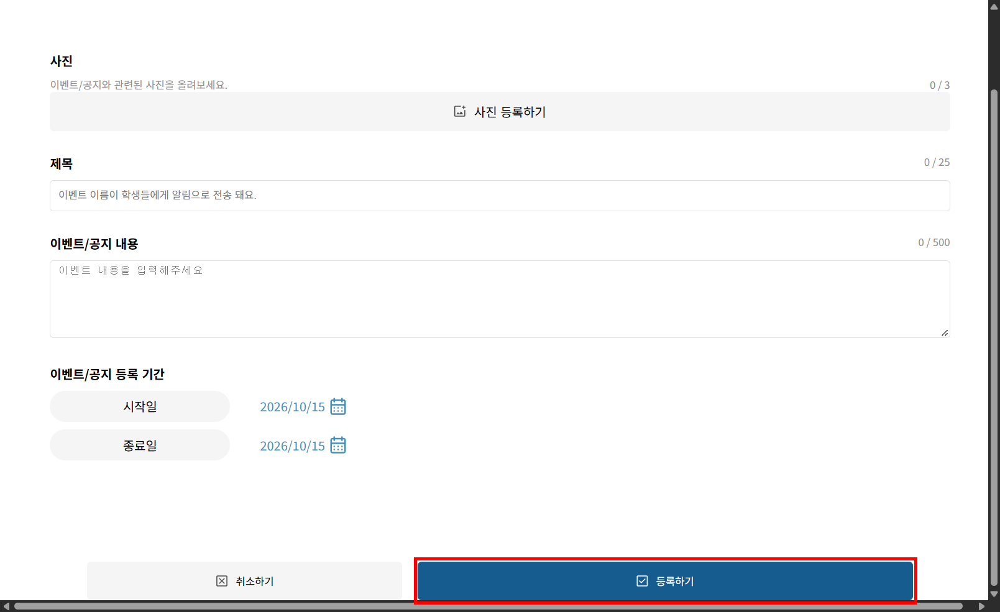

# 1-2 이벤트 추가 - 등록하기

원문 페이지 ID: 87b0221954bc822aad9d01241b3aa411

> 원문 스냅샷. 명세 확정·앱 배포·수집 완료를 뜻하지 않습니다.

## 원문 속성

```json
{
  "platform": [
    "WEB"
  ],
  "url": "source-page-id:87b0221954bc822aad9d01241b3aa411",
  "상태": "완료",
  "생성일": "2026-11-12T05:07:39.307Z",
  "이벤트 이름": "1-2 이벤트 추가 - 등록하기",
  "태그": [
    "1. 이벤트 추가"
  ]
}
```

<details>
<summary>과거 로깅</summary>

<span color="orange">event\_params.key</span>

- event\_label : add\_event\_register
- value : 이벤트 추가 완료
- event\_category : click
</details>

<details>
<summary>새 로깅</summary>

- 설명: 사장님 이벤트 추가 화면에서 제목·내용·기간을 입력한 뒤 등록하기 버튼을 클릭해 이벤트를 등록하는 경우
- screen\_view: <code>owner_event_add</code>
- event\_name: <code>DA1</code>
- event\_label: <code>owner__owner_event_add__shop_event_manage__add_confirm__click</code>
- value: 이벤트 등록
- event\_category: <code>click</code>

### 참고사진 (기능 표시)

<columns>
<column ratio="50">
<b>웹</b>

<b>참고사진 · 웹</b>

웹 — 이벤트 등록하기 (출처: stage 실제 캡처, 빨간 네모 = 클릭 위치)


</column>
<column ratio="50">
<b>모바일</b>

<b>참고사진 · 모바일</b>

모바일 — 해당 없음 (웹 전용)
</column>
</columns>
</details>
