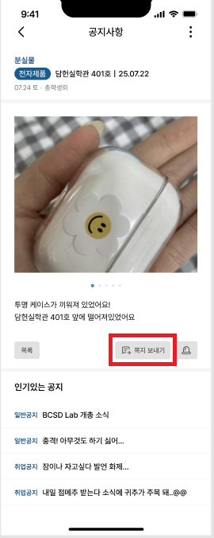
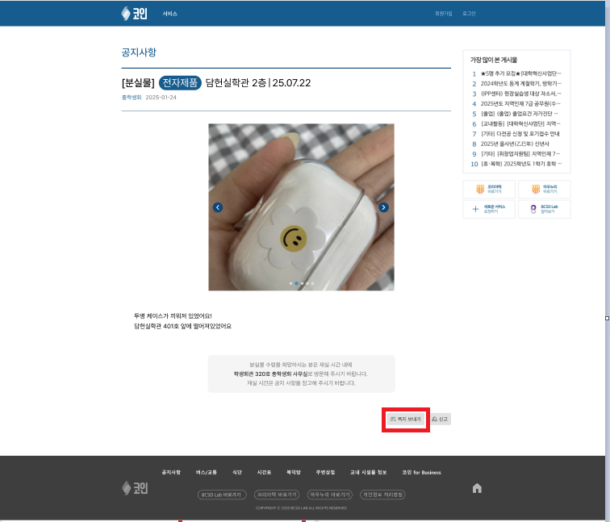
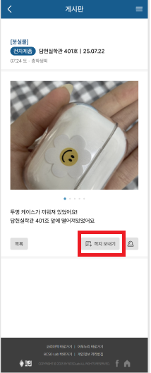

# 11-12.분실물_쪽지보내기_클릭

원문 페이지 ID: 87f0221954bc83329ea20157407117c2

> 누락 원본 복구 스냅샷. 원본의 과거값·검토 기록을 보존하며 생성 계약으로 자동 승인하지 않습니다.

대조 기록: [87개 원본 복구 및 8개 차이 정리](../recovery-review.md)

관련 기존 보관본: [11-12.분실물_쪽지보내기_클릭 ](4760221954bc8274b5018173d2ab4000.md), [11-12.분실물_쪽지보내기_클릭 ](aea0221954bc8206b8b581461a538965.md)

## 원문 속성

```json
{
  "platform": [
    "ANDROID",
    "IOS",
    "WEB"
  ],
  "url": "source-page-id:87f0221954bc83329ea20157407117c2",
  "상태": "완료",
  "이름": "11-12.분실물\\_쪽지보내기\\_클릭"
}
```

- 설명:   게시글에서 쪽지 보내기 버튼 클릭, value 값은 게시글 종류에 따라서 "분실물 쪽지 보내기", "습득물 쪽지 보내기”로 구분
- event\_label : “item\_message\_send”
- value :  "분실물 쪽지 보내기", "습득물 쪽지 보내기”
- event\_category : “click”
- 참고사진

mobile\_view, mobile\_Web\_view





WEB





Mobile\_Web\_View



