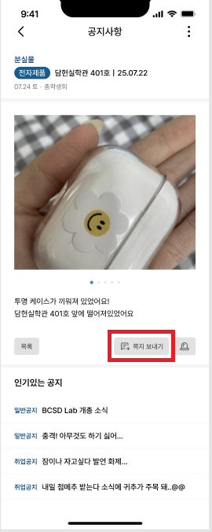
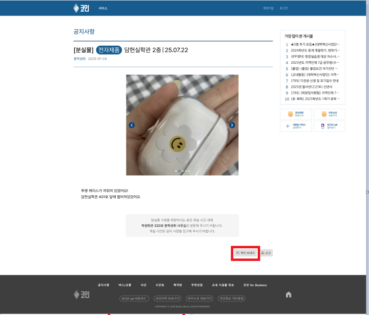
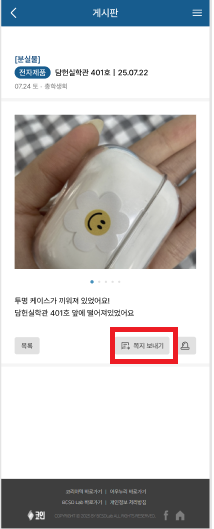

# 11-12.분실물_쪽지보내기_클릭

원문 페이지 ID: 8980221954bc825bacb401ff89daf793

> 사용자 제공 ZIP 내보내기 보관본. 레거시·동결·검토 상태는 원문을 따르며 코드 생성 승인·앱 배포 완료를 뜻하지 않습니다.

platform: ANDROID, IOS, WEB
상태: 완료

- 설명:   게시글에서 쪽지 보내기 버튼 클릭, value 값은 게시글 종류에 따라서 "분실물 쪽지 보내기", "습득물 쪽지 보내기”로 구분
- event_label : “item_message_send”
- value :  "분실물 쪽지 보내기", "습득물 쪽지 보내기”
- event_category : “click”
- 참고사진

mobile_view, mobile_Web_view

WEB

Mobile_Web_View

