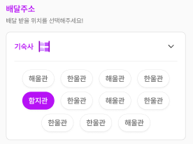

# 7-5 결제 → 교내 주문 페이지 기숙사 위치 설정

원문 페이지 ID: 8980221954bc832694d101784b15bae3

> 원문 스냅샷. 명세 확정·앱 배포·수집 완료를 뜻하지 않습니다.

## 원문 속성

```json
{
  "platform": [
    "WEB"
  ],
  "url": "source-page-id:8980221954bc832694d101784b15bae3",
  "상태": "로깅 필요",
  "생성일": "2026-11-12T05:07:46.552Z",
  "이벤트 이름": "7-5 결제 → 교내 주문 페이지 기숙사 위치 설정",
  "태그": [
    "7. 결제 페이지"
  ]
}
```

<columns>
<column ratio="50">

</column>
<column ratio="50">

</column>
</columns>


2번에 해당하고 세부 기숙사 클릭 시 로깅입니다


event\_params.key

- event\_label : payment\_campus\_dormitory
- value : 해울관(101), 예지관(102), 예솔관(103), 다솔관(104), 함지관(105), 한울관(106), 솔빛관(201), 청솔관(202), IH관(203), 은솔관(204), 참빛관(205)
- event\_category :
  - click
